# docvi · Markdown 阅读器与编辑器

**把任意 Markdown 目录变成可浏览、可搜索的文档应用。**

一个桌面应用：左侧目录树、右侧正文。打开本地文件夹就能读，改一个字刷新就见效。

[功能设计](docs/architecture/README.md) · [安全策略](SECURITY.md) · [贡献指南](CONTRIBUTING.md)

[](LICENSE)
[](https://github.com/OneFanki/docvi/actions/workflows/verify.yml)
[](https://www.electronjs.org/)
[](https://vuejs.org/)

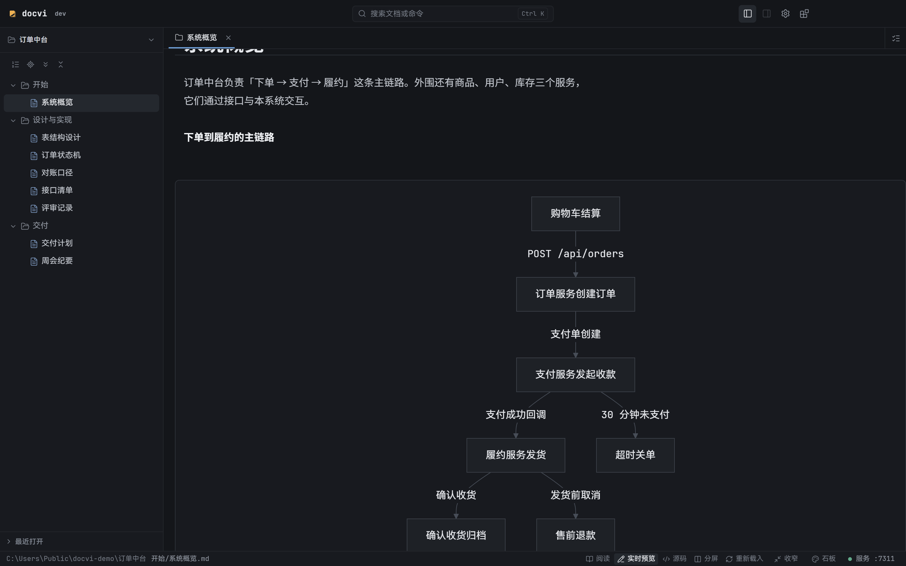

## 为什么

我用过不少 Markdown 编辑器，最后还是在用自己写的这个。原因很具体：

- **打开就能读**：把一个文件夹拖进来，它就是一个文档站，不需要生成站点、不需要等构建；
- **标签像 VSCode**：单击是预览（斜体，再点别的就替换），双击才固定。同时看十篇也不会攒出十个标签；
- **零编译**：Markdown 原文直出，浏览器端渲染。改完刷新即见，没有「等构建」这一步；
- **只写通用格式**：标准 GFM、mermaid、`::: tip` 容器、原生 HTML。换成 Obsidian、Typora 或 GitHub 打开，内容照样成立。

## 核心：读与写

左侧目录树、右侧正文。编辑时**看不到 Markdown 语法** —— `**加粗**` 直接显示成加粗，
`## 标题` 就是一个标题。

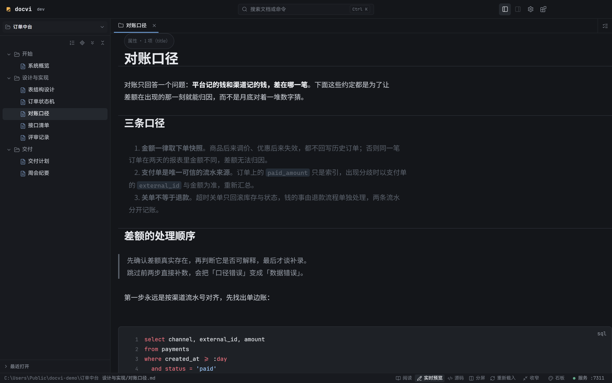

选中任意文字会浮出工具条：加粗、斜体、删除线、行内代码、链接、列表、引用、标题。都是原地改语义，不弹对话框。

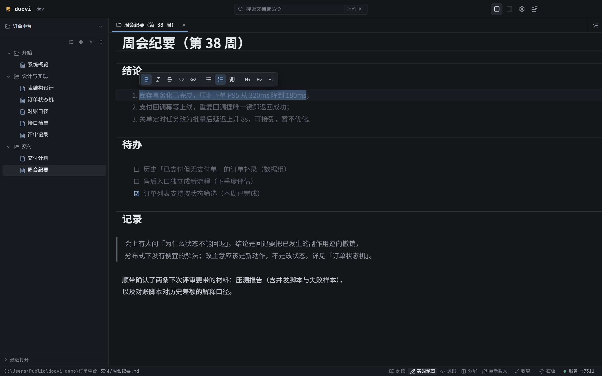

四种视图共用同一份缓冲区：

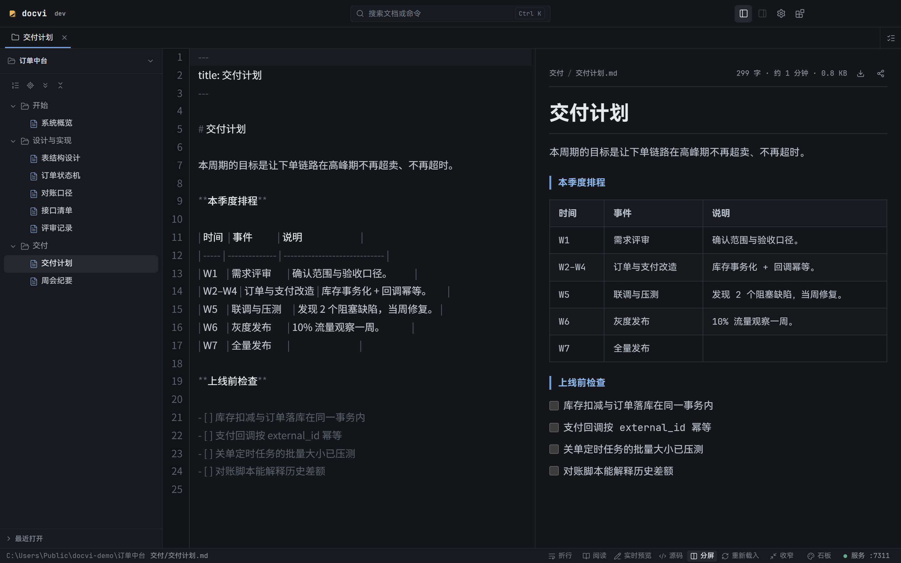

| 模式     | 用途                              |
| -------- | --------------------------------- |
| 阅读     | 只读渲染结果，最接近读者看到的    |
| 实时预览 | 所见即所得，隐藏标记（默认）      |
| 源码     | 纯 Markdown，等宽字体，可切换折行 |
| 分屏     | 左源码右渲染，改左边右边立刻变    |

切换视图不会丢东西：正在看的那一段仍在视野里，撤销栈也还在（切回去按 `Ctrl+Z` 继续撤）。

## 图表怎么写

图表是**标准 Markdown 的一部分**，不是这个应用私有的语法：

- **流程图 / 状态机 / 时序图**：` ```mermaid ` 代码块，GitHub 与 Obsidian 都能渲染；
- **表格**：标准 GFM 表格，列多了会自动吸顶表头、冻结首列；
- **折叠**：原生 `<details>` / `<summary>`；
- **数学公式**：`$E = mc^2$` 行内、行首 `$$` 成块，TeX 语法（KaTeX 排版）；
- **交互式图解**：`<iframe sandbox="allow-scripts" src="./demo.html">` 内嵌你自己写的 HTML。

也就是说，**文档离开 docvi 也是完整的**。这是 1.0 的取舍：不做只有本应用能读的富组件。

流程图与状态机就是普通的 mermaid 围栏，改数据即改图：

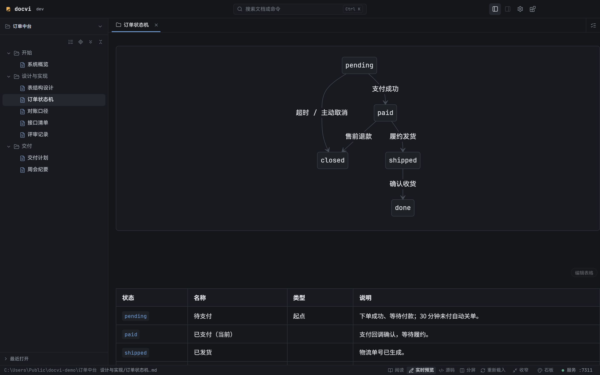

表格是原生的 GFM 表格，列多了会自动吸顶表头、冻结首列：

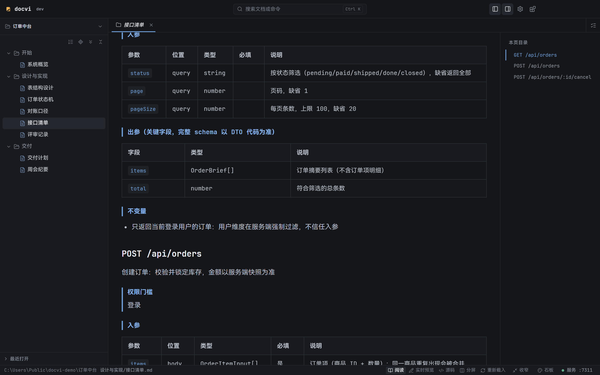

“决定 / 理由 / 证据”这类判断也只需要标题加表格，不需要自定义卡片：

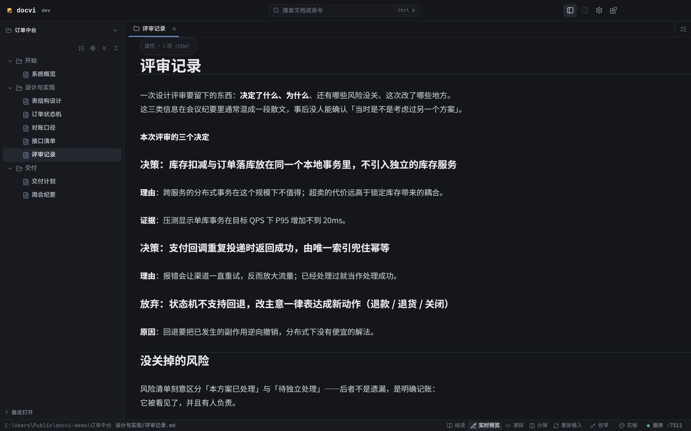

阅读态是干净的两栏，右侧是可选的本页目录——不带任何编辑控件：

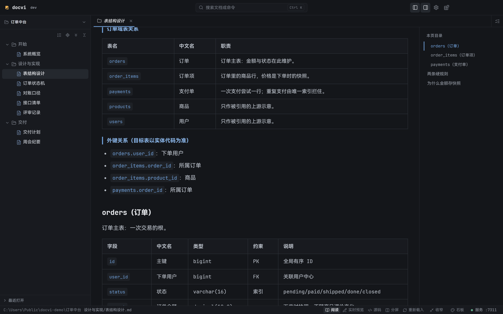

多标签各自记住每篇读到哪儿，切回来还是原处：

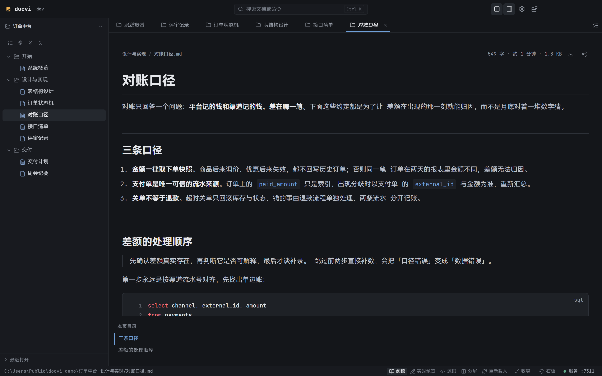

浅色主题是同一套配色体系的另一侧，不是简单反色：

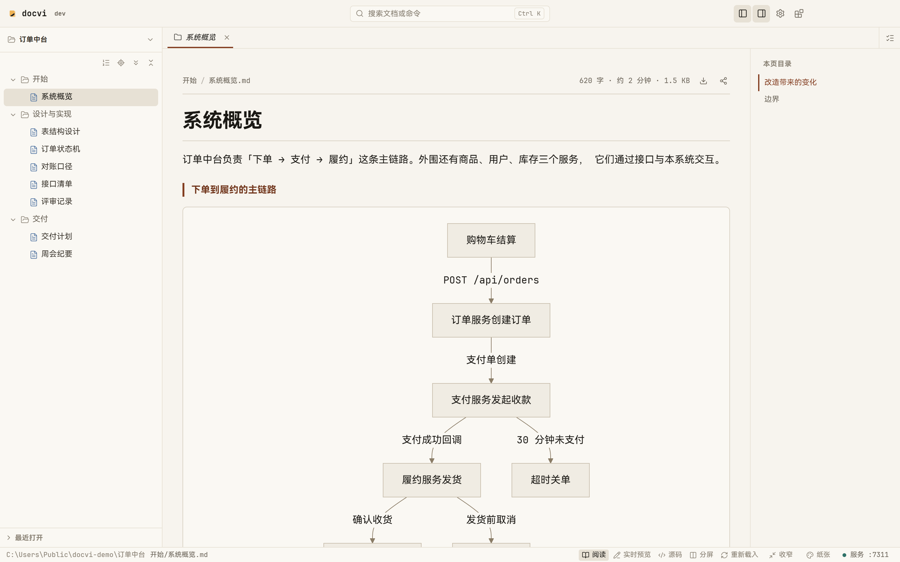

## 给 AI 用

本地服务对外暴露一个 MCP 端点（Streamable HTTP），把你的工作区内容交给 AI 客户端：

```
http://127.0.0.1:<port>/mcp
```

六个工具：`list_plugins`、`get_plugin_docs`、`search_docs`、`read_doc`、`list_workspaces`、`write_doc`。
工作区增减会自动同步到服务。

`write_doc` 默认只新建、不覆盖已有文档；改已有文档要先 `read_doc` 拿到 mtime，
再带 `baseMtime` 覆盖（期间被别人改过会失败）。

所以你可以直接问「这个项目的部署流程是什么」，它去你的文档里找答案，而不是凭印象编。
端点与令牌在 设置 → 对外访问 里，一键复制成一整段客户端配置。默认只绑 `127.0.0.1`，
显式打开「允许局域网访问」才会对同网段可见。

## 临时分享

想把一篇文档发给同事看，不用提交、不用部署：在文档页点「分享」，或在左栏工作区
切换器的菜单里分享整个目录，拿到一条 `/s/<id>/` 链接。

分享是**路径代理**，不是复制：链接每次读的都是磁盘上的当前文件，删掉或改了立刻生效；
停用分享或关掉服务，链接立刻失效。链接 id 是 64 bit 随机值，**链接即权限** ——
分享功能没有账号体系，也不打算有。

默认只允许自己访问；打开「允许局域网访问」后，同网段的同事才能打开。

## 插件

插件系统保留，但目前**只承载主题**：一个插件里可以有多套配色。

第三方插件走**远端清单**：`plugins/market.json` 发布到 GitHub，客户端拉取并缓存在本机
（一小时，可手动刷新），离线时回退上次缓存并明确标注。条目带 `artifact.manifest` 的
可以一键安装（按 manifest 逐个拉单文件并校验 sha256）；没有的只能打开仓库。
也可以选「从文件夹安装」装一个已构建好的包。

不提供 tarball / zip 整包下载：解包校验要引入归档库，而安装器刻意保持零运行时依赖。

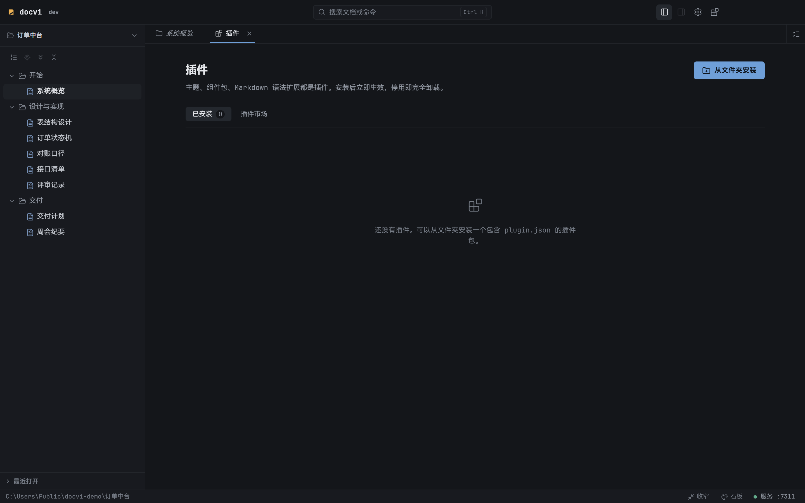

## 设置

主题、语言、源码折行、内容宽度、标签页上限都与文档分开管，改完立即生效。
「对外访问」管的是本地服务：MCP 端点、令牌、端口、局域网开关、开机自启与
关闭窗口后是否留在托盘。

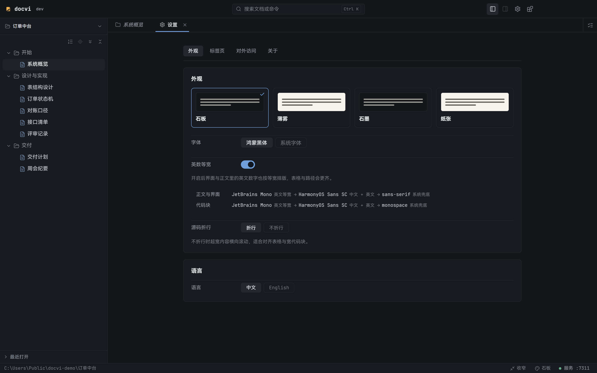

主题是**整套**配色——窗口、正文、编辑器一起变，不是三个互不相干的开关。

## 安装

从 [Releases](https://github.com/OneFanki/docvi/releases) 下载安装包。

发布产物**没有代码签名**（个人开源项目不购买证书），首次运行系统会提示来源不可信，
属于预期行为：Windows 点「更多信息」→「仍要运行」。

macOS 安装说明：

1. 下载 `docvi-<版本>-mac-<架构>.dmg`，打开后把 docvi 拖入「应用程序」；
2. 首次打开若提示「无法验证开发者」，到「系统设置 → 隐私与安全性」点「仍要打开」；
3. 若提示「已损坏，无法打开」（Chrome 下载会带 quarantine 标记，ad-hoc 签名过不了
   Gatekeeper），在终端执行一次：

   ```bash
   xattr -dr com.apple.quarantine /Applications/docvi.app
   ```

随后正常双击即可。每次升级替换 `/Applications/docvi.app` 后如再次被拦，重复第 3 步。

## 开发

要求 Node.js ≥ 22.18 与 pnpm 12（`corepack enable` 即可）。

```bash
pnpm install
pnpm docvi:dev        # 开发态（Electron + Vite 热更新）
pnpm verify           # 全量门禁：格式 / lint / 类型 / 构建 / 单测 / 端到端 / 文案 / 文档 / 边界 / 敏感内容
pnpm test             # 单元测试
pnpm docvi:build      # 构建产物 → apps/desktop/out
pnpm docvi:dist       # 出安装包 → apps/desktop/release
pnpm verify:app       # 拉起真实 Electron 跑一遍核心交互（需先 build）
pnpm verify:iframe    # iframe 内嵌的端到端验证
pnpm screenshots      # 重新生成 README 截图（需先 docvi:build）
```

`pnpm install` 会自动补齐 Electron 二进制（根 `package.json` 的 `postinstall` 钩子）。
这一步不能省：Electron 42 起移除了包内 `postinstall`，而 `electron-vite` 只读现成的
`path.txt`、读不到就直接报 `Electron uninstall`，不会自己下载。

配了代理时，钩子会自动补 `ELECTRON_GET_USE_PROXY=true`——`@electron/get` 走 Node 原生
fetch，不设这个变量时它**不认** `HTTP(S)_PROXY`，只会抛一句看不出原因的 `fetch failed`。

如果仍然失败，单独重试下载脚本（同样需要代理变量）：

```bash
node node_modules/electron/install.js
```

CI 不需要这套：设 `ELECTRON_SKIP_BINARY_DOWNLOAD=1` 时钩子直接跳过，不下载用不上的 158MB。

`screenshots` 用的是无头模式（`DOCVI_HEADLESS=1`）：窗口停到屏幕之外、不建托盘、
每张图一个独立的临时数据目录，跑完即删。所以它可以在你正在用电脑的时候跑，
不会弹窗抢焦点，也不会碰你的真实文档。

## 内容怎么写

内容根目录下放一份 `docs.config.yaml` 说明哪些目录进树，子目录自动递归；
`index.md` / `索引.md` / `README.md` 是目录的落地页。

```yaml
title: 我的文档站
sidebar:
  - text: 设计
    path: 设计
    order: 10
exclude:
  - drafts/
nav:
  - text: 首页
    link: /
```

正文里能用的表达只有通用格式：GFM（含表格、任务列表）、mermaid、`::: tip / note / info / warning / danger` 容器、原生 HTML。写法细则见 `docs/engineering/内容写法.md`。

## 架构

```
apps/desktop/            唯一渲染层 + 桌面宿主
├── src/main/            窗口 / 托盘 / IPC / 文件操作 / 服务托管
├── src/preload/         contextBridge 白名单桥（window.docvi）
├── src/renderer/        Vue 3 UI
└── src/service/         服务进程：MCP / 临时分享 / 检索语料

packages/
├── shared/              进程间契约：IPC 通道、DocviApi、设置与类型
├── renderer-core/       Markdown 管线：渲染、代码高亮、mermaid、主题
├── editor/              CodeMirror 6：实时预览装饰层、H1 徽标、行前缀
├── plugin-api/          插件协议类型
├── plugin-runtime/      插件清单校验
└── server/              服务层（纯 Node）：MCP / 分享 / 语料

plugins/                 插件市场清单（第三方插件不随安装包分发）
```

三条硬约束：

1. **宿主差异只有一个收口处** —— `window.docvi`，由 preload 提供。
   渲染层不许逐个探测「这个方法存不存在」来决定行为。
2. **服务只有一份实现** —— MCP、临时分享、检索语料只在 `packages/server`，
   桌面服务进程必须复用。
3. **依赖方向单向** —— 渲染进程不碰 `node:` / `electron`，主进程不 import 渲染层，
   由 `pnpm check:boundaries` 守护。

## 非目标

- **不做云端协作**：没有账号体系、没有实时协同、没有评论。
- **不做私有格式**：不引入只有本应用能渲染的富组件。文档离开 docvi 必须仍然可读。
- **不做通用绘图工具**：要画图用 mermaid 或内嵌 HTML，不自建画布。
- **不做 Word / 富文本导出**：导出是「打印型」的——Markdown、HTML、PDF 三种都只是把同一份
  排版结果落成文件，不生成可再编辑的 docx。要分发更省事的方式是发链接（临时分享）。

## 贡献

欢迎 issue 和 pull request。提交前先读 [CONTRIBUTING.md](CONTRIBUTING.md)——
特别是「`pnpm verify` 全绿」这一条：它是唯一门禁，CI 跑的是同一个。

安全问题请按 [SECURITY.md](SECURITY.md) 私下报告。参与本项目即表示同意
[行为准则](CODE_OF_CONDUCT.md)。

## License

[MIT](LICENSE) © 2026 docvi contributors
