# docvi · 交互式文档系统

**把 Markdown 目录变成可读、可搜、可交互的文档站。**
图表、状态机、表设计、接口清单都是正文的一部分 —— 不导出图片，不另开绘图工具。

一个桌面应用：左侧目录树，右侧正文；打开本地文件夹就能读，改一个字刷新就见效。
同一份界面也能跑在容器里，当成团队共享的只读文档站。

[功能设计](docs/architecture/README.md) · [安全策略](SECURITY.md) · [贡献指南](CONTRIBUTING.md)

[](LICENSE)
[](https://github.com/OneFanki/docvi/actions/workflows/verify.yml)
[](https://www.electronjs.org/)
[](https://vuejs.org/)

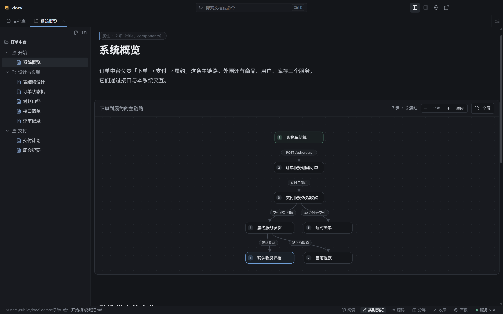

## 为什么

技术文档写到一定程度，Markdown 就不够用了。

一个订单状态机，用文字描述清楚要写三段，读者还得自己在脑子里画图；一段接口约定，
参数表和「哪条规则不能破」混在一起，改的时候没人能确认有没有碰到红线；一次改动的范围，
散在十几个 commit 里，评审时只能靠回忆。

成熟的方案是上一套文档框架 + 一套绘图工具 + 一个 Diagram-as-Code 服务。代价是：
图是图片，改图要重新导出；图与正文的措辞对不上没人发现；图里的数据改不了，
因为它已经是一张 png 了。

docvi 的选择是：**图表也是正文**。数据用 YAML 写在文档头部，正文里用一个标签引用它，
浏览器现渲染成图。改数据即改图，`git diff` 里看得见改了什么，图和正文永远是同一版。

## 核心：实时预览

左侧目录树、右侧正文。编辑时**看不到 Markdown 语法** —— `**加粗**` 直接显示成加粗，
`## 标题` 就是一个标题，鼠标移到行首会浮出 `H1` 徽标，点开就能改级别。

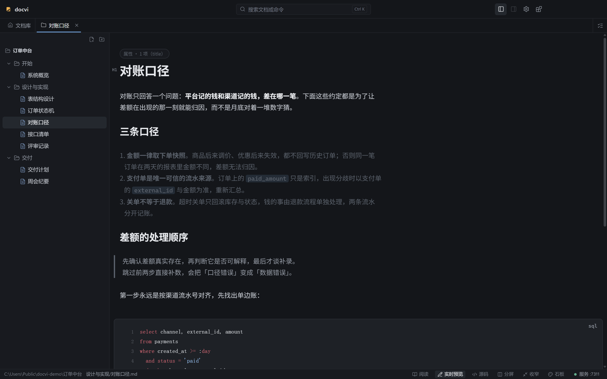

选中任意文字会浮出工具条：加粗、斜体、删除线、行内代码、链接、无序 / 有序列表、引用、
三级标题。都是原地改语义，不弹对话框。

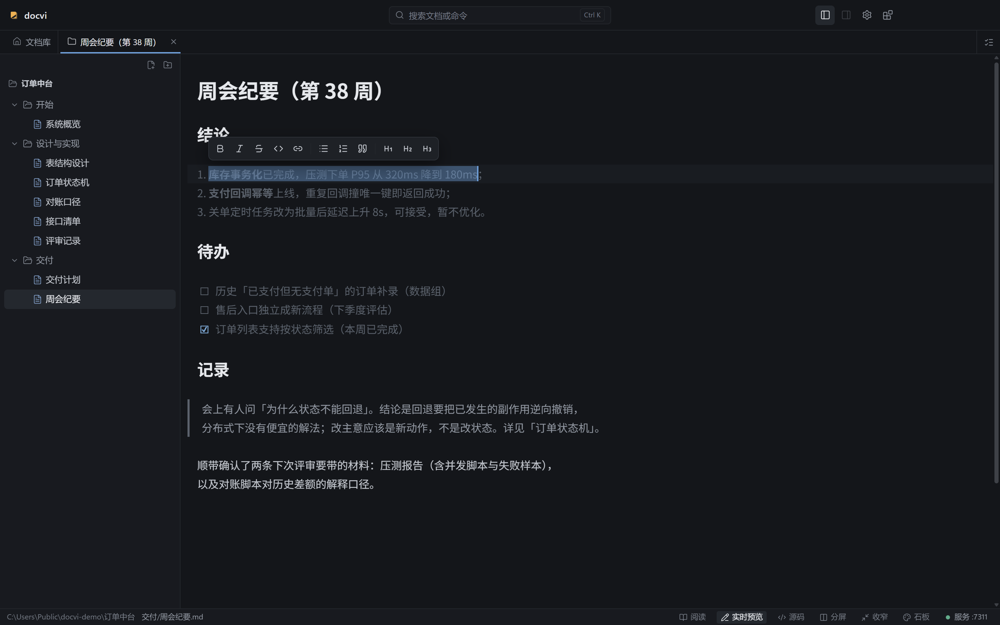

想看原文就切模式，四种视图共用同一份缓冲区：

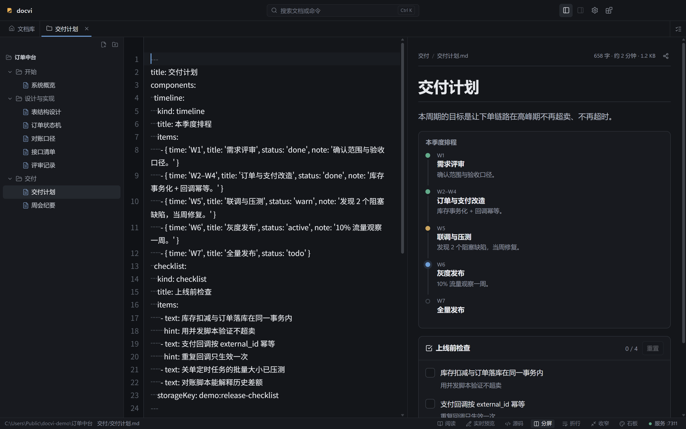

| 模式     | 用途                              |
| -------- | --------------------------------- |
| 阅读     | 只读渲染结果，最接近读者看到的    |
| 实时预览 | 所见即所得，隐藏标记（默认）      |
| 源码     | 纯 Markdown，等宽字体，可切换折行 |
| 分屏     | 左源码右渲染，改左边右边立刻变    |

## 把结构画出来

文档里可以直接写图表。它们的共同点是：**数据在 frontmatter 里，正文只放一个引用标签**，
所以图是文档的一部分，不是附件。

### 流程图与状态机

节点、连线、标注都是数据。分支、回边、跨行的长边由布局引擎处理 —— 它做三件事：
断环识别、最长路径分层、重心排序降交叉。

状态机会标出当前状态，一眼看出这笔订单在哪一步；下面紧跟着同一页的风险清单：

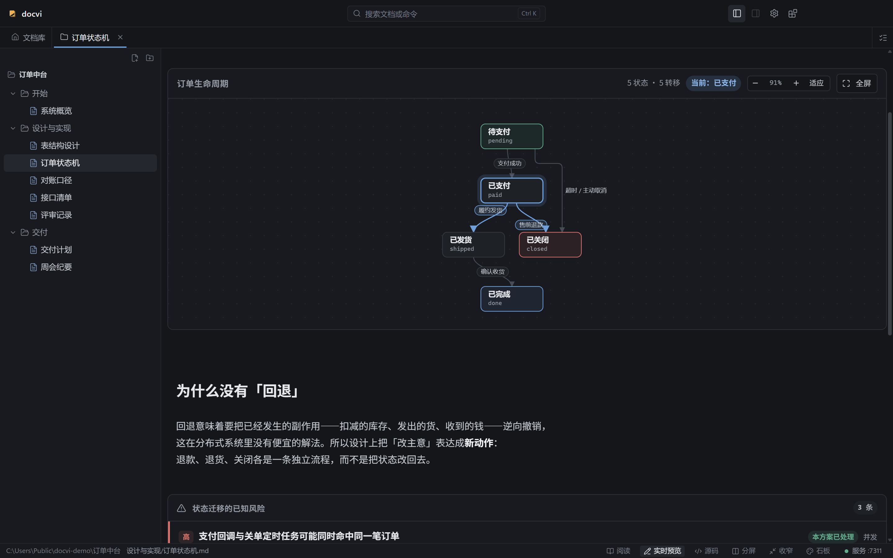

### 表关系

表卡带字段与主外键标记，外键连线可悬停高亮整条链路。表多的时候靠分层布局
而不是让你自己摆位置：

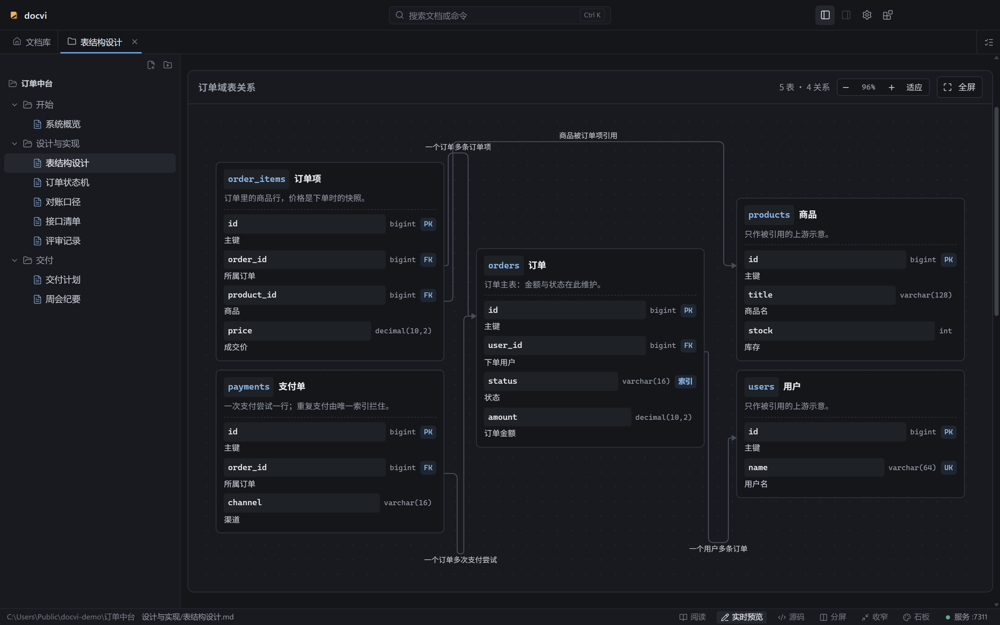

### 接口清单

默认折叠成一行，点开看完整契约。每个接口除了参数与响应，还有一节**不变量**——
那些无论怎么改实现都不能破的规则：

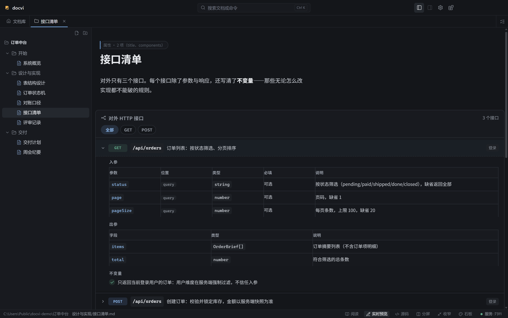

### 还有这些

时序图、调用树、代码走读（行号 + 分步高亮）、决策卡、风险清单、改动清单、
验收清单、指标卡、时间线、diff 视图、合并单元格表格、以及一个可以塞任意自包含
HTML 的沙箱容器。全部 24 个见 [组件协议](docs/architecture/组件协议.md)。

决策卡与风险清单记的不是数据，是判断：每条决定固定三段——结论、理由、证据；
风险清单把「已处理」和「待独立处理」分开记账，后者不是遗漏，是已经有人认领的已知项。

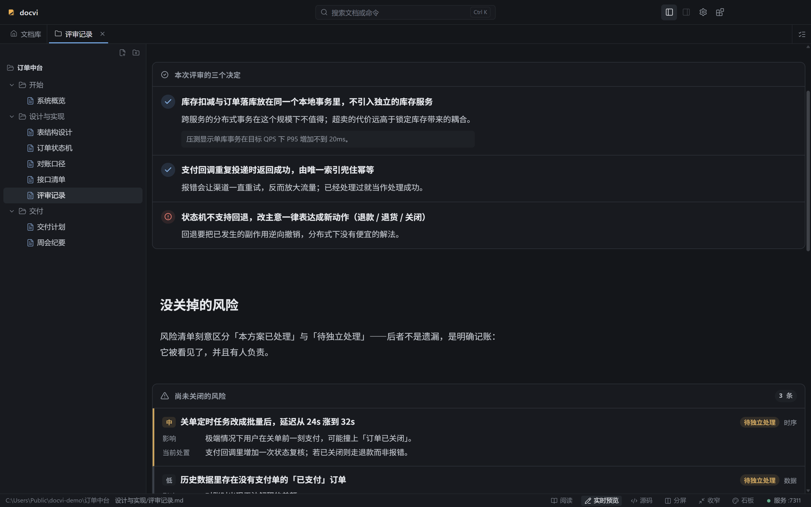

## 两种用法，一份界面

同一份代码可以跑成两种形态，差别只在宿主能力由谁提供：桌面由 Electron preload 提供，
容器由一层 HTTP 适配层提供。**界面不另写第二套**，做不到的能力自动隐藏，不会露出
点了必然失败的按钮。

### 桌面应用

打开本机任意文件夹，它就是文档库。能力：

- **编辑**：四种模式、选区工具条、表格可视化编辑、斜杠插入组件
- **文件**：新建 / 重命名 / 移动 / 复制 / 删除，拖放 `.md` 打开，`.md` 文件关联
- **Git**：克隆仓库、切分支、拉取；平台自持副本，绝不碰你的工作目录
- **多标签**：标签是「内容源 + 路径 + 滚动位置」，不持有 DOM；支持新开、复制、重排
- **查找**：`Ctrl+F` 文档内查找，命中高亮与计数
- **本地服务**：MCP 端点与临时分享（见下），关窗口留托盘，服务继续跑
- **主题**：石板 / 薄雾 / 石墨 / 纸张四套内置，插件也能带自己的主题

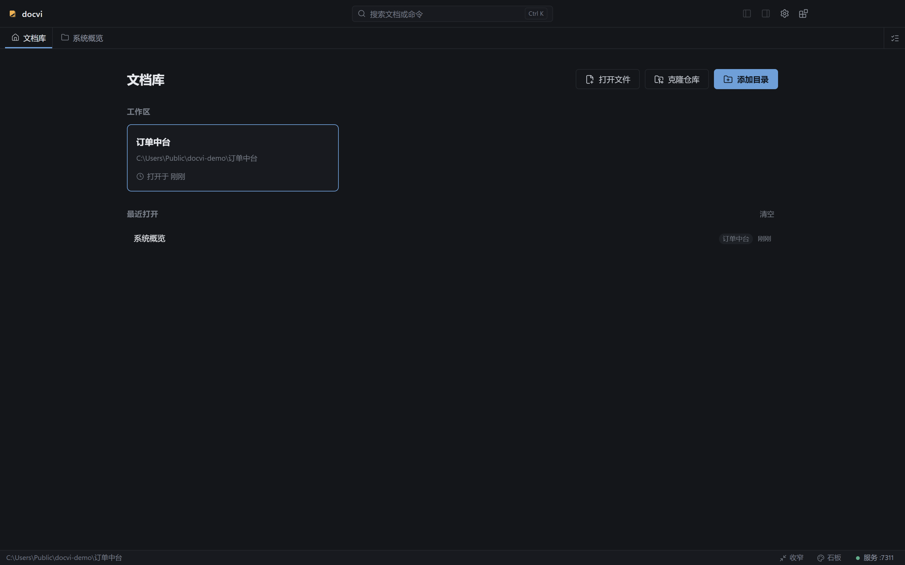

阅读态是干净的两栏，右侧是可选的本页目录——不带任何编辑控件：

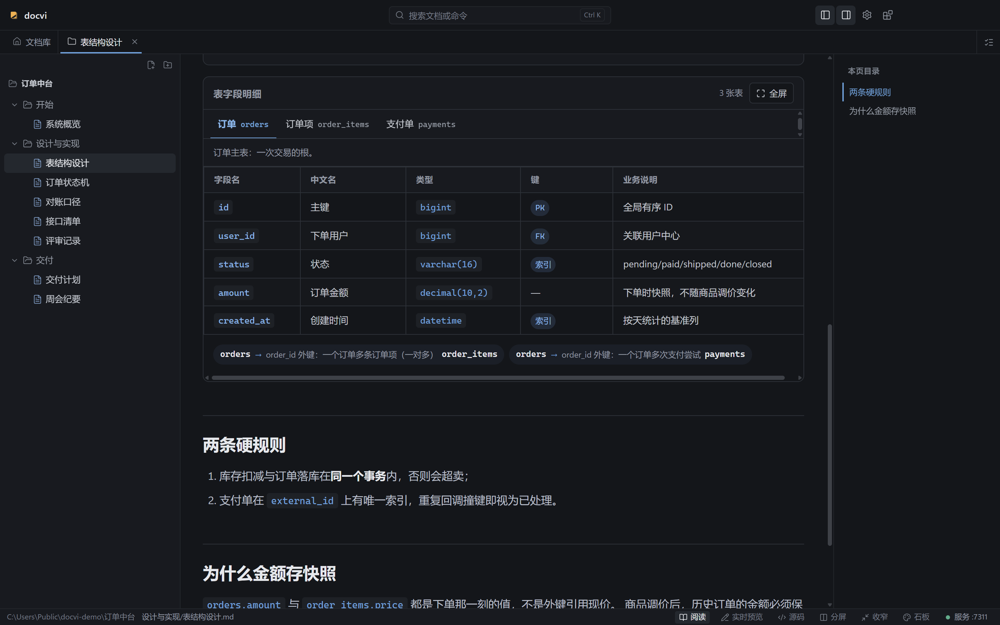

多标签各自记住自己的目录展开状态和每篇读到哪儿，切回来还是原处：

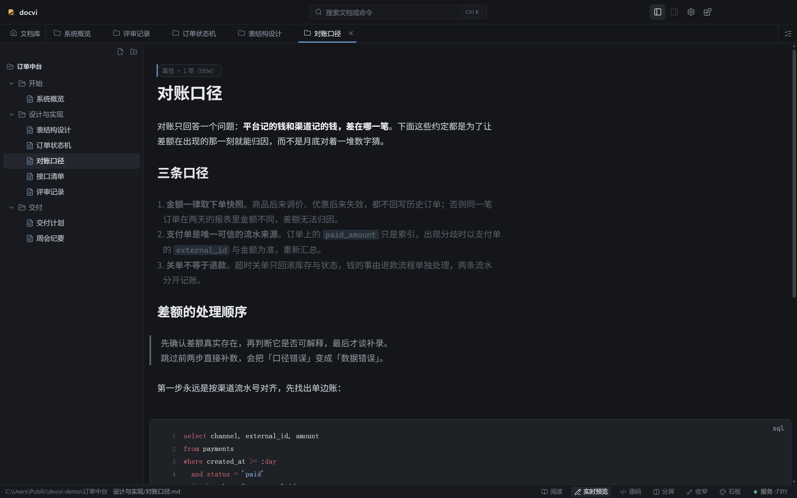

浅色主题是同一套配色体系的另一侧，不是简单反色：

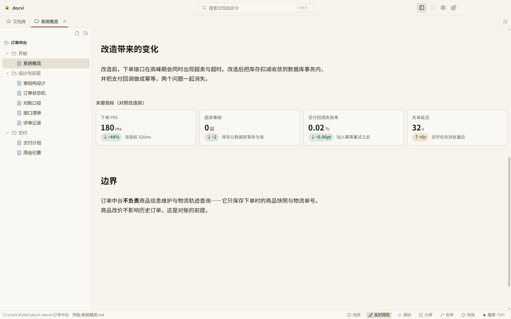

### 容器站点

```bash
cp .env.example .env      # 填 OPS_TOKEN（必填）
docker compose up -d --build
# 打开 http://localhost:8080/_/admin → 添加 Git 仓库 → 自动克隆并首次刷新索引
```

容器版是**读者面**：多仓库编排、分支切换、索引刷新队列、门户，但没有本地磁盘、
git 客户端与插件安装。运维面在 `/_/admin`，由 `OPS_TOKEN` 门禁；
**没配这个变量时运维面整体关闭**，只剩门户与文档站可访问。

## 给 AI 用

本地服务对外暴露一个 MCP 端点（Streamable HTTP），把你的工作区内容交给 AI 客户端：

```
http://127.0.0.1:<port>/mcp
```

六个工具：`list_plugins`、`list_components`、`get_component_docs`、
`get_plugin_docs`、`search_docs`、`read_doc`。工作区增减会自动同步到服务。

所以你可以直接问「订单为什么不能回退状态」，它去你的文档里找答案，而不是凭印象编。
端点与令牌在 设置 → 对外访问 里，一键复制成一整段客户端配置。默认只绑 `127.0.0.1`，
显式打开「允许局域网访问」才会对同网段可见。

## 临时分享

想把一篇文档发给同事看，不用提交、不用部署：在文档页或工作区卡片点「分享」，
拿到一条 `/s/<id>/` 链接。

分享是**路径代理**，不是复制：链接每次读的都是磁盘上的当前文件，删掉或改了立刻生效；
停用分享或关掉服务，链接立刻失效。链接 id 是 64 bit 随机值，**链接即权限** ——
分享功能没有账号体系，也不打算有。

默认只允许自己访问；打开「允许局域网访问」后，同网段的同事才能打开。

## 插件

主题、组件包、Markdown 语法扩展都是插件。内置两个：`docs-plugin-base`（24 个通用组件）
与 `docs-plugin-audio`（三个音频教学图）。它们随安装包发布，**没有「安装」这个动作** ——
固定出现在「已安装」页签里，只能启停。

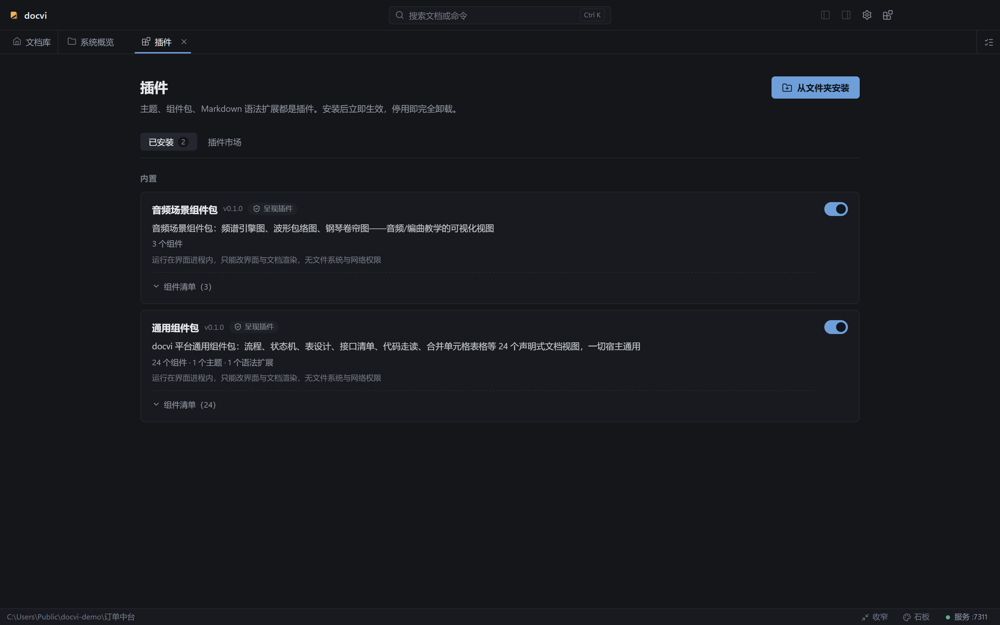

第三方插件走**远端清单**：仓库里的 `plugins/market.json` 发布到 GitHub，客户端打开市场页
时拉取并缓存在本机（一小时，可手动刷新）。离线时回退上次缓存并明确标注。
新增插件 = 改那一份文件，不需要发版。

市场条目不提供一键安装：那需要下载 tarball 解包校验，而安装器刻意保持零运行时依赖。
需要时装一个已构建好的包（「从文件夹安装」），或由容器运维面安装。

## 设置

主题、语言、源码折行、内容宽度、标签页上限都与文档分开管，改完立即生效。
「对外访问」管的是本地服务：MCP 端点、令牌、端口、局域网开关、开机自启与
关闭窗口后是否留在托盘。

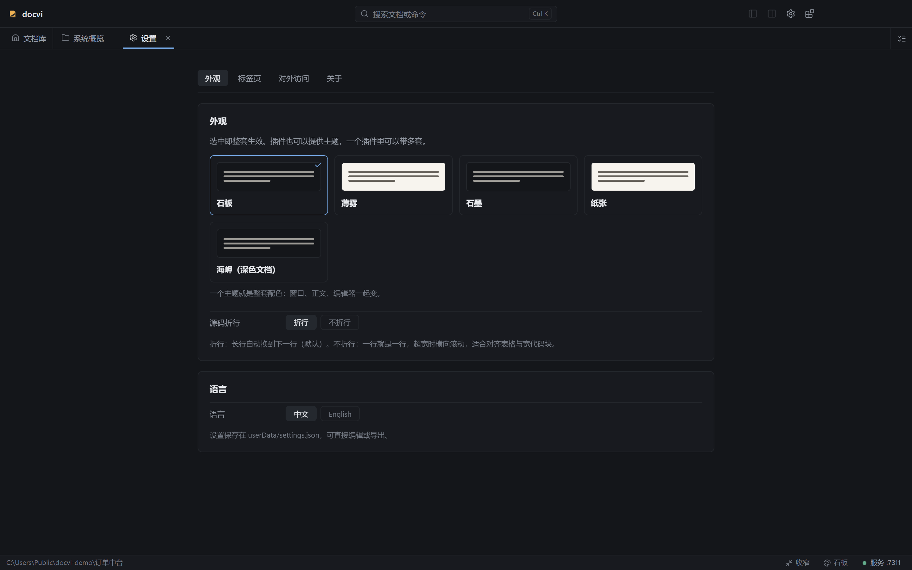

主题是**整套**配色——窗口、正文、编辑器一起变，不是三个互不相干的开关。
插件也能带主题，一个插件里可以有多套。

## 安装

从 [Releases](https://github.com/OneFanki/docvi/releases) 下载安装包。

发布产物**没有代码签名**（个人开源项目不购买证书），首次运行系统会提示来源不可信，
属于预期行为：Windows 点「更多信息」→「仍要运行」；macOS 右键 →「打开」确认一次。

> 当前为 0.x 阶段，数据格式与接口可能变化。

## 开发

要求 Node.js ≥ 22.18 与 pnpm 12（`corepack enable` 即可）。

```bash
pnpm install
pnpm docvi:dev        # 开发态（Electron + Vite 热更新）
pnpm verify           # 全量门禁：格式 / lint / 类型 / 构建 / 单测 / 文案 / 文档 / 边界 / 敏感内容
pnpm test             # 单元测试
pnpm docvi:build      # 构建产物 → apps/desktop/out
pnpm docvi:dist       # 出安装包 → apps/desktop/release
pnpm screenshots      # 重新生成 README 截图（需先 docvi:build）
pnpm docvi:build:web  # 容器版前端产物 → apps/desktop/dist-web
```

首次安装 Electron 需要访问外网。如果你的网络需要代理，先按代理客户端显示的端口设置：

```bash
export HTTPS_PROXY=http://127.0.0.1:<port>
export HTTP_PROXY=http://127.0.0.1:<port>
pnpm install
```

端口由你使用的代理软件决定，以它界面上显示的本地监听端口为准。

如果 `node_modules/electron/dist` 不存在，单独重试下载脚本：

```bash
node node_modules/electron/install.js
```

`screenshots` 用的是无头模式（`DOCVI_HEADLESS=1`）：窗口停到屏幕之外、不建托盘、
每张图一个独立的临时数据目录，跑完即删。所以它可以在你正在用电脑的时候跑，
不会弹窗抢焦点，也不会碰你的真实文档。

## 内容怎么写

内容根目录下放一份 `docs.config.yaml` 说明哪些目录进树，子目录自动递归；
`index.md` / `索引.md` / `README.md` 是目录的落地页。

```yaml
title: 我的文档站
sidebar:
  - text: 设计
    path: 设计
    order: 10
exclude:
  - drafts/
nav:
  - text: 首页
    link: /
```

组件的用法见组件协议与自带示例内容根 `courses/`——那是可运行的活样例，
不是文档片段。

## 架构

```
apps/desktop/            唯一渲染层 + 桌面宿主
├── src/main/            窗口 / 托盘 / IPC / git / 文件操作 / 服务托管
├── src/preload/         contextBridge 白名单桥（window.docvi）
├── src/renderer/        Vue 3 UI
├── src/service/         服务进程：MCP / 临时分享 / 检索语料（可独立运行）
└── vite.web.config.ts   容器版产物

packages/
├── shared/              进程间契约：IPC 通道、DocviApi、设置与类型
├── renderer-core/       Markdown 管线：渲染、插件块、高亮、mermaid、主题
├── editor/              CodeMirror 6：实时预览装饰层、H1 徽标、行前缀
├── plugin-api/          插件协议类型
├── plugin-runtime/      插件清单校验与容器
└── server/              服务层（纯 Node）：MCP / 分享 / 语料 / HTTP 原语

plugins/                 内置组件包（base 24 个 / audio 3 个）
deployer/                容器化部署器（复用 packages/server）
```

三条硬约束：

1. **宿主差异只有一个收口处** —— `window.docvi`。界面问 `hostKind` 与能力表，
   不许逐个探测「这个方法存不存在」。
2. **服务只有一份实现** —— MCP、临时分享、检索语料只在 `packages/server`，
   deployer 与桌面服务进程必须复用。
3. **依赖方向单向** —— 渲染进程不碰 `node:` / `electron`，主进程不 import 渲染层，
   由 `pnpm check:boundaries` 守护。

## 非目标

- **不做云端协作**：没有账号体系、没有实时协同、没有评论。文档的真相源是 git。
- **不做所见即所得的富文本编辑器**：Markdown 原文永远是事实，编辑器只是不让你背语法。
- **不做通用绘图工具**：组件是给「讲清楚一件事」用的，不是 Freeform 画布。
- **不做 WYSIWYG 导出**：不生成 PDF / Word。要分发就发链接。

## 贡献

欢迎 issue 和 pull request。提交前先读 [CONTRIBUTING.md](CONTRIBUTING.md)——
特别是「`pnpm verify` 全绿」这一条：它是唯一门禁，CI 跑的是同一个。

安全问题请按 [SECURITY.md](SECURITY.md) 私下报告。参与本项目即表示同意
[行为准则](CODE_OF_CONDUCT.md)。

## License

[MIT](LICENSE) © 2026 docvi contributors
