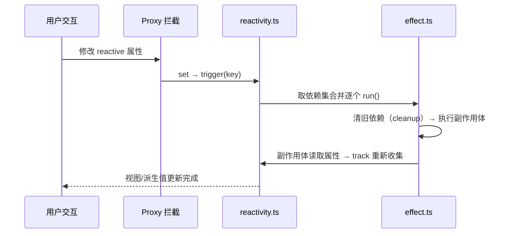

---
components:
  tutorialShell1:
    kind: tutorial-shell
    courseTitle: Vue 响应式系统
    step: 3
    stepTotal: 4
    goals:
      - 读懂 track：依赖是如何被收集的
      - 读懂 trigger：更新是如何被触发的
      - 读懂 effect：为什么需要「清理后重收集」
  codeWalkthrough2:
    kind: code-walkthrough
    title: reactive / track / trigger
    language: ts
    code: |
      // 教学片段①：数据平面 —— reactive proxy、依赖收集 track、触发更新 trigger
      // 配套片段②见 effect.ts；这里 import 的 ReactiveEffect 由 effect.ts 提供
      // 「读取收集依赖、修改触发更新」是整个响应式系统的主骨架，其余都是围绕它展开的。
      import type { ReactiveEffect } from './effect'

      type Dep = Set<ReactiveEffect>

      /** 当前正在执行的 effect 栈（由 effect.run() 压栈/出栈） */
      const activeEffectStack: ReactiveEffect[] = []

      /** 依赖表：target -> key -> effects 集合 */
      const targetMap = new WeakMap<object, Map<string, Dep>>()

      /** 读取属性时收集依赖：把当前 effect 记入该属性的依赖集合 */
      export function track(target: object, key: string) {
        const active = activeEffectStack[activeEffectStack.length - 1]
        if (!active) return

        let depsMap = targetMap.get(target)
        if (!depsMap) {
          depsMap = new Map()
          targetMap.set(target, depsMap)
        }
        let dep = depsMap.get(key)
        if (!dep) {
          dep = new Set()
          depsMap.set(key, dep)
        }
        if (!dep.has(active)) {
          dep.add(active)
          active.deps.add(dep) // 反向登记，供 cleanup 使用
        }
      }

      /** 修改属性时触发更新：依次执行该属性的所有依赖 effect */
      export function trigger(target: object, key: string) {
        const depsMap = targetMap.get(target)
        if (!depsMap) return
        const dep = depsMap.get(key)
        if (!dep) return
        for (const runner of [...dep]) {
          runner.run()
        }
      }

      /** reactive：用 Proxy 拦截读写，读时收集、写时触发 */
      export function reactive<T extends object>(target: T): T {
        return new Proxy(target, {
          get(target, key, receiver) {
            if (typeof key === 'string') track(target, key)
            return Reflect.get(target, key, receiver)
          },
          set(target, key, value, receiver) {
            const result = Reflect.set(target, key, value, receiver)
            trigger(target, String(key))
            return result
          },
        })
      }
    steps:
      - title: track：收集依赖
        lines:
          - - 15
            - 33
        note: 从活跃 effect 栈取「当前正在执行的 effect」，把它加入该属性的 Set。读取发生在渲染/计算时，所以这里就是「谁用了它，就记下谁」。
      - title: trigger：触发更新
        lines:
          - - 36
            - 44
        note: 修改属性时，取出该属性依赖的 effect 集合，逐个 run()。拷贝成数组再遍历，避免执行中断言变更集合。
      - title: reactive：读收集写触发
        lines:
          - - 47
            - 58
        note: Proxy 拦截读（get → track）与写（set → trigger）。这就是「读取收集、修改触发」落地的地方。
  codeWalkthrough3:
    kind: code-walkthrough
    title: ReactiveEffect 与依赖清理
    language: ts
    code: |
      // 教学片段②：effect 平面 —— 副作用执行与「清理后重收集」的生命周期
      // activeEffectStack / Dep 来自 reactivity.ts（与片段①同属一个迷你响应式模块）
      import { activeEffectStack } from './reactivity'
      import type { Dep } from './reactivity'

      export class ReactiveEffect {
        /** 反向记录自己依赖了哪些 dep，清理时逐一解绑 */
        deps: Set<Dep> = new Set()

        constructor(public fn: () => void) {}

        /** 执行副作用：先清旧依赖，再压栈运行，确保 track 能取到当前 effect */
        run() {
          cleanupEffect(this)
          activeEffectStack.push(this)
          try {
            return this.fn()
          } finally {
            activeEffectStack.pop()
          }
        }
      }

      /** 建立副作用并立即运行一次（顺带完成首次依赖收集） */
      export function effect(fn: () => void) {
        const _effect = new ReactiveEffect(fn)
        _effect.run()
        return _effect
      }

      /** 解绑 effect 与所有 dep，避免「不再依赖的属性仍触发更新」 */
      function cleanupEffect(target: ReactiveEffect) {
        for (const dep of target.deps) {
          dep.delete(target)
        }
        target.deps.clear()
      }
    steps:
      - title: run：清旧依赖 + 压栈执行
        lines:
          - - 13
            - 21
        note: 先 cleanupEffect 清掉旧依赖，再把自己压进 activeEffectStack，这样 track 才能取到它；finally 里出栈。
      - title: effect：首次运行完成收集
        lines:
          - - 25
            - 29
        note: effect() 建立实例后立即 run() 一次——副作用函数体里的每一次属性读取，都会在这次运行中完成依赖收集。
      - title: cleanupEffect：解绑旧依赖
        lines:
          - - 32
            - 36
        note: 被解绑的 effect 不会再被 trigger。这就是「条件分支结束后，副作用不再触发」的实现基础。
---
# 03 · 核心流程讲解

<at-tutorial-shell data-key="tutorialShell1"></at-tutorial-shell>

上一章理清了「谁负责什么」，本章逐个函数读两份核心实现：数据平面的 `reactive` + `track` + `trigger`，以及副作用平面的 `effect`。先用「上一步 / 下一步」按钮，跟着高亮走一遍，再读下面的讲解。

## 数据平面：reactive + track + trigger

<at-code-walkthrough data-key="codeWalkthrough2"></at-code-walkthrough>

### 为什么 `trigger` 要拷贝成数组再遍历

`[...dep]` 拷贝出快照。因为 effect 在执行时可能修改依赖集合（重新收集/清理），
如果边遍历边改原 Set，顺序和结果都会变得不可预期。拷贝快照是最稳的做法。

## 副作用平面：effect

<at-code-walkthrough data-key="codeWalkthrough3"></at-code-walkthrough>

### 为什么每次运行前都要清理

考虑一个有 `if/else` 的 effect：第一次运行走了 `if` 分支，只依赖了 `a`；第二次条件变了走 `else` 分支，只依赖 `b`。
如果没有清理，`a` 变化时仍会触发这个**已经不再依赖 `a`** 的 effect，造成多余更新。先清旧、再重收集，依赖永远和实际一致。

## 全流程时序

> 下一步：[04 · 契约与边界](/sample-course/chapters/04-契约与边界) —— 设计决策、常见误区与本教程刻意省略的内容。
