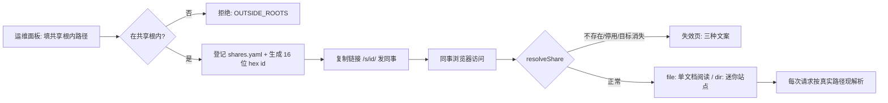

# 平台临时分享与颜色增强

> 状态：容器端 + app 端已落地（阶段一）｜ app 端服务进程化（2026-10-16 晚，随 MCP 托管）｜ 负责人：Fanki ｜ 创建：2026-10-16 ｜ 更新：2026-10-16（app 端迁出独立服务进程）

## 一、功能定位

**一句话**：两块"小而锋利"的能力——① **行内代码颜色增强**：md 里写在行内代码中的颜色字面量（`#RRGGBB` 等）自动带真实色块展示；② **临时分享**：把本机文件/目录生成 `/s/<id>/` 链接给局域网同事临时查看——**不复制内容，只做实时路径代理**，文件移动/删除或停用后链接立即失效。

**用户价值**：设计文档里的色阶表一眼可见颜色真身；写完给 UI 看的临时文档不需要建仓库、不需要上传，一个链接就够。

**术语**：分享（share，{随机 id, 目标路径, 启停} 的登记条目）；共享根（share root，容器内允许被分享的目录白名单）；代理（每次请求按真实路径现解析、零内容复制）；能力链接（不可枚举的随机链接即访问凭证）。

## 二、业务规则

- **R1 颜色增强（默认开 + 文档级可关）**：仅对**行内代码**（code chip 语法位置）识别颜色字面量——hex 3/4/6/8 位与 rgb/rgba/hsl/hsla 函数式（参数个数 3-4 校验）；命中在值前挂 10px 色块，值原样保留、可复制。**不认 named 颜色**（red 等普通词误报不可接受）；不装饰正文纯文本与代码块；表格单元格自动覆盖（同一 inline 规则）。文档 frontmatter `colors: false` 关闭本页。
- **R2 分享 = 路径代理，零复制**：内容永不被复制进平台存储；每次请求按登记的路径实时读取。文件移动 / 删除 → 链接自然失效（失效页区分「不存在 / 已停用 / 目标消失」三种文案）。本机（容器）关机即不可达——这是"临时"的诚实语义。
- **R3 生成与管理**：运维页「临时分享」面板——填共享根内路径 + 可选显示名 → 创建；列表项支持复制链接 / 停用 / 恢复 / 撤销（撤销两段确认）。链接形如 `http://<主机>:<端口>/s/<16位hex>/`，**`s` 为保留段**（独立命名空间，与仓库 slug 无冲突）。
- **R4 安全边界**：分享目标**必须在共享根内**（`SHARE_ROOTS` 环境变量，容器里由 compose 的 `SHARE_HOST_DIR` 挂载）——防的是运维面泄露后遍历全盘；链接不可枚举（64bit 随机）即访问凭证，内网 HTTP 前提下可接受；查看者永远只读。谁的本机谁管理（撤销在自己手里），无账号体系。
- **R5 两种分享形态**：**file**（单文档阅读页——单篇渲染、无搜索语义、资产限文档同目录；图片经 `/s/<id>/assets/<相对路径>` 代理）；**dir**（迷你站点——完整目录树 + 搜索 + 章节跳转，复用平台渲染管线；图片经 `/s/<id>/<相对路径>` 代理）。
- **R6 分享页的标识**：header 显示「临时共享」徽标（提示链接由分享者电脑实时提供、随时可能失效）；首页/logo 链接回分享根（不跳去平台首页）。
- **非目标（明确不做）**：团队共享容器不做普通上传（"谁都能传上去"= 需要账号体系的真场景，刻意不进临时档；仅保留「运维 token 上传型分享」的将来位置）；app 端与容器端同源跟落（见附录：阶段一仅单文件分享；目录分享 / 二维码 / 拖拽散文件留待后续）。

## 三、流程与状态机

分享状态：`enabled ↔ disabled`；目标存在于否为运行时判定（非状态）；撤销 = 删除登记（不可恢复）。

## 四、权限与边界

| 角色                   | 能做什么                                                |
| ---------------------- | ------------------------------------------------------- |
| 局域网同事（持链接者） | 只读浏览分享的文件 / 目录（file 单文档 / dir 迷你站点） |
| 运维 token 持有人      | 创建 / 停用 / 恢复 / 撤销分享；查看共享根挂载状态       |
| 分享者（本机主人）     | 即运维 token 持有人——文件系统与分享管理都在自己机器上   |

**边界**：与仓库浏览——`/s/` 是独立命名空间（保留段），不参与多仓库/分支模型；与插件——分享页复用同一壳与插件运行时（组件在分享页同样工作）；与 git——分享对象是**本机文件**，不需要是 git 仓（临时内容不建仓就是本功能的动机）。

## 五、数据设计

本功能**无数据库表**；持久化 = `<dataDir>/shares.yaml`（独立于 config.yaml——分享高频增删、生命周期独立）。

<TableTabs title="分享登记条目（以 deployer 代码为准）" :tables="shareTabs" />

**环境配置**：`SHARE_ROOTS`（容器内共享根，分号分隔，默认 `/share`）；compose 的 `SHARE_HOST_DIR`（本机目录 → `/share` 挂载）。

## 六、接口设计

<EndpointList title="临时分享端点（运维 4 + 公开代理 6）" :endpoints="shareEndpoints" />

不变量：代理路由全部按真实路径现解析（零内容复制）；`/s/` 与 `/<slug>/` 命名空间互斥；壳在 `/s/<id>/` 前缀下自动前缀化站内链接与图片（file 模式资产走 `/assets` 子路径）。

## 七、设计取舍

<DecisionCard title="临时分享与颜色增强关键决策（2026-10-16 拍板）" :decisions="shareDecisions" />

## 八、验收标准

- AC1 颜色增强：`#RRGGBB` / `#RGB` / `#RRGGBBAA` / rgb()/rgba()/hsl()/hsla() 行内代码带色块且值可复制；named 颜色与正文纯文本不装饰；代码块不装饰；`colors: false` 关闭本页（验证：单测 + CDP；已过）
- AC2 文件分享：创建 → `/s/<id>/` 单文档阅读（含颜色色块渲染、搜索入口隐藏、站内链接前缀化）（验证：CDP 已过）
- AC3 目录分享：树 / 章节跳转 / 搜索 / 图片（`/s/<id>/<相对路径>` 代理实际加载成功）（验证：CDP 已过）
- AC4 失效链路：不存在 → 404 失效页；停用 → 「已被停用」文案；文件移动 → 「目标消失」文案；恢复后立即可访问（验证：脚本已过）
- AC5 共享根边界：根外 / 不存在路径创建被拒（错误码明确）（验证：单测已过）
- AC6 颜色增强在分享页同样工作（同一渲染管线）（验证：CDP 已过）
- AC7 全量回归：脚本 49 / deployer 53 / typecheck 双配置 / 三变体构建（验证：脚本）
- AC8 app 端分享（阶段一·单文件）：工作区首页「临时分享」入口 → 面板启动服务（默认仅本机）→ 添加文件 → 打开 `/s/<id>/` 单文档阅读；「允许局域网访问」开关后才可从其它设备访问；失效三因页与容器端同文案（验证：`packages/server` 分享单测 + deployer 分享单测 + typecheck + 双产物构建；真机 E2E 待复核）

## 九、前端设计

- **运维页「临时分享」面板**（`#opsBody` 门禁内）：路径 + 显示名输入 → 生成链接；列表项（badge：文件/目录、已停用、目标已消失；操作：复制链接 / 停用 / 恢复 / 撤销）；共享根挂载状态提示；创建成功提示「局域网同事用你的 IP 替换 localhost」。
- **分享页（读者侧）**：header「临时共享」徽标（脉冲点）；file 模式单文档渲染 + 搜索隐藏 + 目录树单条；dir 模式完整侧栏 + 搜索；失效页（自渲染，区分三种原因 + 「临时分享是本地文件的代理」说明）。
- **颜色色块**：10px 圆角方块 + 中性半透明内描边（深浅两主题通用），不改变行内代码既有外观。
- **app 端「本地服务」面板**（Electron 宿主，入口在工作区首页；2026-10-16 晚由「临时分享」面板升级）：服务区块（状态与启停 / 端口管理（运行中只读）/ 「允许局域网访问」开关 / **MCP 地址一键复制** / 开机自启动双档 / 关闭后留托盘开关 / 查看服务日志）+ 分享列表（链接、复制 / 停用 / 启用 / 移除）+「添加文件」系统文件选择（只放 Markdown）。默认只绑 127.0.0.1（仅本机验证），显式打开局域网开关后才绑 0.0.0.0（同事才可达）。

## 九·五、本地预览（容器版，2026-10-19）

**场景**：部署在服务器时，用户常用服务器 MCP 生成文档，文件在本地、提交 git 之前无处预览；也不该为了看一眼就装桌面 app 或拉整个仓库。

**方案**：站点首页的「预览本地文档」卡片——拖入目录、散文件或点选，内容经浏览器 File API 读成文本、在**内存**里装载（复用 viewer 的 `LocalContentSource` + 同一套渲染管线），路由切到 `/__local/…` 前缀。

- **不经过服务端**：不上传、不落盘、不写任何仓库；刷新即失效，回首页即丢弃。
- **能力边界**：只读渲染，无分享、无保存；单篇/多篇/整目录都支持；`.md` 与 `docs.config.yaml` 之外的文件不预载（图片仍按文档相对路径解析，容器预览下不保证加载）。
- **路由登记三处**：壳启动分派、壳 `loadDoc`、deployer 的 `/_` 兜底白名单（`/__local` 必须放行，否则深链刷新 404）。
- **验收**：拖入单篇 Markdown → 正文/侧栏/本页目录正常、地址为 `/__local/<doc>`；点「首页」回站点首页且内存内容丢弃；刷新任意 `/__local/…` 深链安静回落首页；`deployer/test/routes.test.mjs` 锁放行与 404 两侧语义。

## 十、关联文档

- 阅读侧复用方向：[平台自研壳与多宿主迁移.md](平台自研壳与多宿主迁移.md)（分享页 = 壳的第四装载形态；与「手机端/单文件查看」立项方向复用单文档阅读件）
- 插件化（分享页复用插件运行时）：[平台插件化与 AI 分发.md](平台插件化与 AI 分发.md)
- 部署（共享根挂载）：[文档平台部署与多仓库管理.md](文档平台部署与多仓库管理.md)

## 附录一：app 端实现（2026-10-16 跟落，阶段一·单文件；当晚改服务进程托管）

**形态**：独立服务进程（`apps/desktop/src/service/`，Electron 时代以 Node 重写；协议实现复用 `packages/server`，与容器端共用 `http-kit`），只做三件事——伺服渲染层资产、**按真实路径代理分享的文件**（零内容复制）、**`/mcp` 端点**（AI 客户端直连，见插件化设计 6.3）。分享页复用同一套渲染层前端（与容器端同一套逻辑），等价于容器端 `deployer` 的 `/s/*` 路由 + 插件目录的最小实现（`/api/plugins` + `/plugins/…` 供分享页的插件运行时装载）。**平台 app 负责拉起与托管**（面板启停 / 端口管理 / 开机自启动 / 托盘），**平台退出不影响服务运行**。分享路由判定在 `packages/server/src/shares.mjs`（纯函数，独立单测）。

**端点（与容器端代理端点同构的 file 子集）**：`/s/<id>/api/meta`、`/s/<id>/api/doc`、`/s/<id>/assets/<相对路径>`（限文档同目录）+ 渲染层资产 `/assets/…` + 插件 `/api/plugins`、`/plugins/<name>/<version>/<path>`。另有 `/health` 与 `POST /control/stop`（仅回环可达）。

**与容器端的三处必要差异**：

1. **绑定策略**：默认只绑 127.0.0.1（仅本机验证）；**0.0.0.0 仅在用户显式打开「允许局域网访问」时启**（UI 开关，状态随 `shares.json` 持久化）——与将来 `/mcp` 本地端点共用同一服务基建。
2. **无共享根**：app 端分享的是"用户自己机器上的文件"，主人即用户，白名单无意义（容器端需要是因为运维面泄露面）。
3. **服务端先判失效**：分享页壳入口（`/s/<id>/…`）由服务端先查登记状态——不存在/停用/目标消失渲染三因文案页（与容器端 `shareGonePage` 同口径），有效才放壳。避免把壳放出来让它显示「内容源不可用」的笼统错误。根路径 `/` 落一个说明页（同事把链接裁剪成裸地址时明确"这不是网站入口"）。

**持久化**：`<appData>/shares.json`（shares/port/lan；无数据库；服务进程与平台共读）。**ID 生成**：时间纳秒 ⌄ 计数混合（xorshift），非加密随机——同机同刻不可预测性对「用户自控链接泄露面」足够。

**安全**：资产与文档路径全经 `safe_rel_path`（拒 `..` 段与反斜杠）；文件选择器只放 `.md`（分享页按文档渲染，二进制只会乱码）；服务只读，无任何写端点。

**留待后续**：目录分享（树/搜索——容器端索引器已有，app 端需本地索引）、二维码给手机扫、拖拽散文件（不经文件选择器）、每分享单独开关之外的访问控制（如有真实需求）。

## 附录二：其它后续方向（本轮不做，已拍板认可）

- **团队容器上传型分享**：仅运维 token 可创建、可选过期时间；与本地共用同一套 `/s/` 概念。等真实需求。
