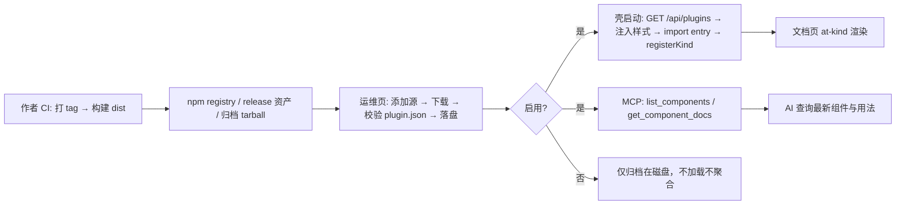
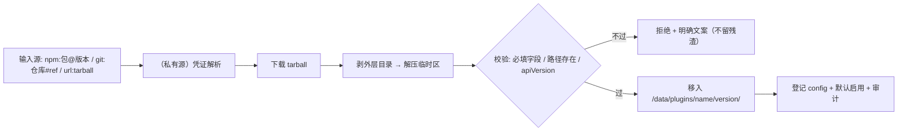

# 平台插件化与 AI 分发

> 状态：设计稿（待拍板）｜ 负责人：Fanki ｜ 创建：2026-10-15 ｜ 更新：2026-10-24（实现位置修订）
>
> **2026-10-24 实现位置修订**：文中 `shell/src/*` 的落地位置已随旧壳删除而迁移——
> 协议类型 → `packages/plugin-api`；清单校验与容器 → `packages/plugin-runtime`；
> 组件注册表与声明式数据桥 → `packages/renderer-core/src/components.ts`；
> 宿主侧注册规则 → `apps/desktop/src/renderer/src/lib/component-registry.ts`；
> 站点侧插件目录与资产伺服 → `deployer/src/plugins.mjs`。
> 协议语义与分发规则不变，本文仍按原样描述**协议与分发**；路径以代码为准。

## 一、功能定位

**一句话**：平台本体只保留壳与插件运行时；组件以「插件包」（manifest + 预构建 ESM + AI 用法文档）的形态从 npm / git 仓归档 / 直链三渠道安装——加插件不改平台代码、不重编译；已启用插件的配置由平台 MCP 聚合，AI 连上即得最新的可用组件与用法。

**用户价值**：

- 组件与平台解耦：不同业务按需安装不同插件包（音频、表单、数据可视化……），平台仓只维护架子与预设包；
- 第三方插件作者：满足一套公开协议（构建发生在自己的 CI）即可被平台安装注册，无需平台改码；
- AI 侧永远最新：MCP 活查询取代静态技能文件，装了 / 禁了插件，AI 查询结果即刻变化。

## 二、业务规则

- **R1 平台 = 架子**：组件注册不集成主仓；新增组件走插件包，平台代码零改动（`src/components/ce/index.ts` 的 KINDS 静态表退役）。
- **R2 单仓多包**：不拆独立 git 仓；平台仓内 `plugins/` 以 workspace 多包形式内置预设包——`base`（通用组件包，现 24 个声明式组件迁入）+ 场景包（首个 `audio`：AudioSpectrumDiagram / PianoRoll / WaveformDiagram 等音视频组件）。**预设包与第三方包同一协议、零特权**（唯一差别：可禁用不可卸载）；第三方插件包各自独立仓。
- **R3 渠道与构建**：插件包一律**预构建**——构建发生在作者 CI（GitHub Actions 打 tag → release 资产；GitLab CI release 资产 / 内置 npm registry / generic packages / 归档直链；均为纯 HTTPS）。平台侧安装不执行包内任何脚本、不需要 git 客户端；凭证可选（公开源免填，私有源 token 复用凭证文件机制）。
- **R4 AI 活查询**：平台提供 MCP（Streamable HTTP），聚合已启用插件的组件清单与用法文档；skills 文件分发保留为快照兜底（junction 机制不变）。
- **R5 失败不伤页面**：单插件加载失败 / 不兼容不影响其他插件与页面；未知 / 已停用 / 未活跃的组件标签原位占位（提示原因与涉及插件）而非静默空白。
- **R6 展示与身份**：展示元数据全部可选、仅作陈列，不参与安装解析与信任判定；公开市场（阶段三）采用策展注册表，身份以来源为准，细则见 4.4。
- **R7 组件级开关与同名切换**：插件内每个组件可单独启用 / 停用（预设包同样适用）——停用后不注册、不进 MCP、不进技能聚合。**kind 跨包不强制唯一**：不同包的组件允许同名，管理面以 `包名/kind` 全限定为身份——base/chart 与 audio/chart 是两个独立组件（各自描述 / 状态 / 版本归属）。同一 kind 同时**至多一个活跃实现**（web 平台约束：`customElements` 一个标签名只能对应一个实现），操作语义为**切换 + 最新者赢**：安装 / 启用引入同名实现时直接激活新实现、原活跃方自动转入停用清单（结果报告替换明细，不阻塞安装流程）；管理面同名双方均标注「存在同名冲突项」，可查看对家全限定名与描述；对被停用的冲突方点「开启」时提示「将停用其他冲突实现（列明）」，确认后原子切换，反向切回同理。运行态兜底：配置被手工改动出现同 kind 双活跃时，双方均不注册、原位占位。
- **R8 AI 选择依据**：组件 `{kind, title, description}` 三字段必填（见 4.2）；MCP 组件清单 = 当前启用面的**活跃实现**（每个 kind 至多一条——AI 看到什么就能写什么），每条带一句话描述；AI 凭描述决定用不用、凭 `get_component_docs` 看用法细节；「用哪个实现」由用户在管理面以切换操作决定，切换后 AI 即刻看到新实现的描述。
- **非目标（明确不做）**：不迁 Electron（评估否决，见七）；平台不执行构建脚本；单文件 viewer 不参与运行时插件（零网络离线是卖点，构建期内嵌预设包）；插件市场 / 内容侧按仓激活 / 容器端源码构建列入阶段三待议。

## 三、流程与状态机

插件全链路：



安装（管理面主流程）：



状态：插件 `installed（禁）↔ enabled`；组件 `enabled（缺省）↔ disabled`（`disabledComponents` 清单，与插件状态正交，停用仅过滤注册与聚合、代码仍随包）；**同 kind 至多一个 enabled——启用引入同名即原子替换（最新者赢），原活跃方自动进停用清单**。更新 = 新版本目录就绪后切换指针并清理旧版本（组件停用清单保留）；卸载 = 删除目录 + 清除登记（预设包拒绝）。

## 四、插件包协议（v1）

### 4.1 目录结构

解包根（npm 包的 `package/` 与归档的 `<repo>-<ref>/` 顶层单目录由安装器统一剥离）：

```
plugin.json        必须 —— 清单（4.2）
dist/index.js      必须 —— ESM 入口（external: vue，禁内置 Vue 副本）
dist/style.css     可选（零到多，manifest 声明）
docs/SKILL.md      必须 —— AI 用法文档（组件清单 + 每种组件的写法与示例；MCP 聚合原料）
```

### 4.2 plugin.json

```json
{
  "name": "docs-plugin-audio",
  "displayName": "音频类组件包",
  "version": "0.3.0",
  "apiVersion": "1",
  "engine": ">=0.1.0",
  "entry": "dist/index.js",
  "styles": ["dist/style.css"],
  "components": [{ "kind": "audio-waveform", "title": "音频波形", "description": "音频文件的波形预览与区间标注" }],
  "docs": "docs/SKILL.md"
}
```

字段：`name`（`[a-z0-9-]` 唯一标识）｜ `displayName` ｜ `version`（semver）｜ `apiVersion`（宿主 API 大版本，不匹配拒载）｜ `engine`（可选，平台版本范围）｜ `entry` / `styles` / `docs`（包根内相对路径）｜ `components[]`（kind 权威清单：MCP 索引 / 技能聚合 / 运维展示共用；每项 `{kind, title, description}` 三字段均必填——description 为一句话功能说明，是 AI 选择组件的第一依据）。**kind 是全平台共享的文档标签命名空间**（md 中写作 `<at-kind>`），建议带领域前缀（audio-waveform、table-graph）降低无意碰撞；跨包同名视为同功能的不同实现，由切换语义管理（见 R7）。**命名惯例**：插件包名建议带发布者 / 组织前缀（npm scope 如 `@fanki/docs-plugin-*`，或 org 前缀如 `fanki-plugin-*`）——冲突治理靠惯例前缀 + 切换兜底，不做强制校验。

可选展示字段（插件「名片」，全部可选）：`description` / `author` / `repository` / `homepage` / `license` / `cover` / `tags`——见 4.4。

### 4.5 协议 v1.1（本地化 / 示例预览 / 运维折叠，2026-10-16 落地）

三项咬合改造（用户拍板「三项 + 国际化一起做」），均向后兼容 v1：

**本地化字段（字符串或语言映射双形态）**：`displayName` / `description`（包级）与 `title` / `description`（组件级）接受两种形态——

```json
"displayName": "通用组件包"                                  // 单字符串 = 全语言通用（兼容 v1）
"displayName": { "zh": "通用组件包", "en": "General Components" }  // 语言映射 = 按语言取
```

- 语言键惯例 `zh` / `zh-CN` / `en`（校验正则 `[a-z]{2,3}(-[a-zA-Z0-9]{2,8})?`）；映射至少一个值、值非空。
- 消费方（运维页 / 壳占位文案）按当前语言解析：精确 → 主语言前缀 → zh → en → 首值；壳侧统一经 `shell/src/i18n.ts` 的 `localizedString()`。
- **kind 永不翻译**——它是 HTML tag 标识与全限定身份的一部分；只译显示名与描述。
- **平台壳 UI 同批国际化**：语言集 zh / en；持久化 key `at-locale`（与运维页共享）；检测序 = localStorage → `navigator.languages` → en 缺省；head 语言按钮 zh↔en，切换 = 整页重载（最稳生效方式）。实现 = gettext 风格（**键 = 中文原文**，`shell/src/i18n-en/` 四片「中文 → 英文」映射，缺译回退原文不阻塞开发）。文档内容不参与 i18n——只覆盖平台壳 UI 与插件元数据。

**组件示例预览（`example` 字段 + `/_/preview` 路由）**：组件清单项可增 `example`（包内相对路径，指向约定格式的示例 markdown——frontmatter `components` 数据 + `<at-kind data-key>` 标签，零 script setup）：

```json
{ "kind": "flow-diagram", "title": {...}, "description": {...}, "example": "examples/flow-diagram.md" }
```

- 运维面板组件行加「预览」按钮 → 新开 `/_/preview/<name>/<kind>`（壳预览路由：取示例原文 → 复用平台渲染管线整页渲染 → 数据桥 / 高亮 / mermaid 全复用）。
- 示例端点：`GET /api/plugins/<name>/example/<kind>`（公开——示例与包文件同口径本就公开伺服；未声明 example 返回 404 NO_EXAMPLE，声明但文件缺失返回 EXAMPLE_MISSING）。
- **「装了才能预览」是事实约束**：示例渲染要加载该插件的组件实现（运行时注册）——本地预览 = 已安装预览。未安装的市场预览（暂存区加载不写激活态）留待阶段三市场立项时一起做。
- 示例文件格式与守卫：`scripts/plugins.test.mjs` 校验声明的 example 文件存在；示例与组件 props 严格对齐（写示例时以组件源码为真相源）。

**运维面板折叠概览**：插件卡外层只显示包概览（显示名 / 包名 + 版本 / 组件数徽标 / 同名冲突数徽标），点击标题区（或 ▾）展开组件列表；组件行改 **title 主显示 + kind 副标**（kind 仍可见可复制——文档作者写标签用的是它）。

### 4.3 入口契约

```js
// dist/index.js
export function activate(host) {
  host.registerKind('audio-waveform', Component, { title: '音频波形' })
}
export function deactivate() {} // 可选；卸载生效在下一页面加载
```

host 最小面（按需扩展——抽象等消费者）：

- `apiVersion`：宿主声明；
- `platformVersion`：平台版本（诊断用）；
- `registerKind(kind, component, meta)`：注册为自定义元素（沿用现 ce 包装逻辑：data-key 属性 + property 注入 + light DOM）；**已停用或重复注册的 kind 由宿主拦截（no-op + 诊断日志），插件无需感知开关状态**。

### 4.4 展示元数据与身份（全部可选）

插件包自带「名片」——即 plugin.json 的可选展示字段（同一文件，不需要第二个配置文件）：

```json
{
  "description": "音频波形、频谱、钢琴卷帘等音视频组件",
  "author": "Fanki",
  "repository": "https://github.com/example/docvi-plugins",
  "homepage": "https://github.com/example/docvi-plugins",
  "license": "MIT",
  "cover": "docs/cover.png",
  "tags": ["audio", "media"]
}
```

字段全部可选；身份分三层，可信度与适用场景不同：

1. **自述（包内字段）**：纯陈列。私有 / 内网部署直接采用——信任边界=内网 git 权限 + 运维 token 持有人（装什么由他决定），无需防伪；不填即隐。
2. **来源（安装解析结果）**：唯一可验证的身份——npm 包名 + scope、git 仓 URL + 属主；持有包名 / 仓库即持有身份。
3. **策展注册表（阶段三插件市场）**：官方维护的精选清单，条目经 PR 审核入表（登记来源 + 展示信息）；市场规则：
   - 条目的 `source` 是安装唯一权威，一键安装只按它解析，包内字段不参与；
   - 显示作者按来源属主推导（`github.com/acme/x` → acme、`npm:@acme/x` → acme）；包内 `author` 与来源冲突时以来源为准；
   - star、最近更新等动态数据由宿主平台 API 实查（GitHub / GitLab），不自报；
   - 封面：未安装取注册表条目 URL；已安装可改伺服包内 `cover`；
   - 详情页=跳转仓库 README（与 dsh 社区市场同模型），平台不另建详情页。

**防伪结论**：名称、作者、封面等自述字段永不参与安装解析、不构成信任（冒写只能误导陈列、不能伪造成来源）；展示层面的同名以「来源 + 作者 + 动态数据」区分（浏览器扩展商店同模型）。

## 五、数据设计

**磁盘布局（容器）**：

```
/data/plugins/<name>/<version>/   第三方包（版本目录并存，更新 = 切指针）
/app/plugins/<name>/              预设包（镜像内，随平台版本）
/data/sync / /data/git / …        既有布局不变
```

**config.yaml 扩展**：

```yaml
plugins:
  - name: docs-plugin-audio
    source: 'npm:docs-plugin-audio@0.3.0'
    version: '0.3.0'
    enabled: true
    builtin: false
    credentialRef: '' # 私有源 token 的凭证条目名（公开源为空）
    disabledComponents: [] # 组件级停用清单（kind 数组，缺省空；更新保留）
```

**app 侧**：预设包随安装包 resources；第三方包下载到应用数据目录 `plugins/`（阶段二）；**技能存储退役**（2026-10-16 拍板，见八）；本地服务配置（端口 / 自启动 / 托盘开关）存应用数据目录 `settings.json`。

## 六、接口设计

### 6.1 公开（壳加载与读者面）

- `GET /api/plugins` —— 生效插件清单（name / version / baseUrl / components（活跃实现，每 kind 至多一条）/ styles / entry / builtin），仅 enabled；
- `GET /plugins/<name>/<path>` —— 插件文件静态伺服（immutable 缓存，与 /assets 同口径）。

### 6.2 运维（token，并入 #opsBody 结构级门禁）

- `POST /api/plugins` —— 添加：`{source, credential?, enabled?}`（`npm:` / `git:` / `url:` 三形态解析下载校验落盘）；缺省启用，引入同名实现时直接激活并替换原活跃方（响应 `replaced[]` 明细）；
- `POST /api/plugins/<name>/enable | disable` —— 插件级启停；启用引入同名实现时**直接原子切换（最新者赢）**，响应附 `replaced[]`（被停用的活跃实现全限定名）；
- `POST /api/plugins/<name>/components/<kind>/enable | disable` —— 组件级启停（同名切换语义同上；UI 发起前给出「将停用 X 的 Y」确认）；
- `DELETE /api/plugins/<name>` —— 卸载（预设包 403 + 文案）；
- `GET /api/plugins`（带 token 时附全量状态：installed / enabled / 各组件启停态 / 同名冲突对家 / 加载错误 / 版本 / apiVersion；公开请求仅返回 enabled 插件的活跃组件清单）。

### 6.3 MCP（Streamable HTTP 最小子集：initialize / tools/list / tools/call）

- 容器：`http(s)://<host>/mcp`（与读者面同源，局域网同事的 AI 直连）；
- app：**本地服务进程托管**（`apps/desktop/src/service`（本地服务进程），独立于平台进程——**平台退出不影响服务运行**）；`http://127.0.0.1:<port>/mcp`（端口由平台管理，默认 8610、面板可改）；「本地服务」面板显示地址 + 一键复制（局域网开启时附 LAN 地址）；**用户配置 = 一条 URL，无需 command / args**；
- 工具面（六工具，两端同源）：`list_plugins` / `list_components` / `get_component_docs(kind)` / `get_plugin_docs(name)` / `search_docs(query, limit?)` / `read_doc(path)`；协议实现只有一份（`packages/server/src/mcp.mjs`），宿主只注入取数回调——**检索回调缺席时后两个工具不出现在 `tools/list`**（工具面 = 宿主能力）；
- `search_docs` 的检索范围：桌面 = 已打开工作区（范围名即工作区名，path 为工作区相对路径）；容器 = 每仓默认分支的工作树（范围名 `<仓库名>@<分支>`，path 带 `<slug>/` 前缀，`read_doc` 据此定向到唯一仓库）。检索为多词 AND、标题命中优先、单篇 1 MB 截断；
- `read_doc` 路径规则：先按前缀匹配，再按范围顺序尝试裸相对路径；绝对路径只在落于某范围内时可读；`..` 段与 realpath 逃逸一律给可读说明（说明文本，不是协议错误）；
- `list_components` 每项返回 `kind / title / description / plugin`（plugin 为全限定身份，description 即 AI 的选择依据）；**每 kind 仅列活跃实现（至多一条）——AI 看到什么就能写什么**；停用插件、停用组件均不出现；`get_component_docs` 对停用 kind 返回「已停用（所属插件 X）」说明而非内容；
- 数据源 = 已启用插件的 plugin.json + docs/SKILL.md（磁盘直读，插件启停 / 组件启停 / 升级即变，无缓存漂移）；
- 认证：默认公开（内容与公开的插件文件等价）；后续可选 token 开关（待定）。
- **本地服务托管（2026-10-16 拍板）**：app 端 MCP 与临时分享由独立服务进程 `apps/desktop/src/service`（本地服务进程） 承载——单端口（默认 8610，平台面板可改）、平台退出不影响服务运行；平台「本地服务」面板管理启动状态 / 端口 / 启停；开机自启动两档（平台 / 仅服务——仅服务档 = 后台运行不开界面）；关闭后留托盘（可配）；优雅停止控制端点仅回环可达。容器端 /mcp 与读者面同源常驻，无托管问题。
- **MCP 展示口径（2026-10-16 修订）**：MCP 不是运维面——**所有写文档者的接入点**，对读者面**固定暴露**：容器端在**站点首页**（最外层）显示「AI 接入（MCP）」卡片（地址 + 一键复制 + 说明），运维面板的提示保留为补充；app 端在「本地服务」面板「MCP 接入」分区显示（localhost + LAN 双地址 + 复制）。

### 6.4 壳运行时（单 Vue 实例）

- 壳构建产出固定命名 `assets/vue-shim.js`（Vue 运行时单独成 chunk），HTML import map 将裸标识 `vue` 映射到该文件——插件与壳解析到**同一模块实例**；
- 启动流程：GET /api/plugins → 注入 `<link>` 样式 → `await import(baseUrl + entry)` → `activate(host)`；启停 / 更新在**下一次页面加载**生效（运维页操作后提示刷新）；
- 开发态：dev 中间件伺服 `plugins/*/dist`（watch 重建），import map 指向 dev 的 vue。

## 七、设计取舍

- **预构建 vs 平台本地编译**：选预构建——不执行任意构建脚本（安全核心）、秒级安装、无工具链漂移；构建责任归作者 CI（GitHub / GitLab 均原生支持 tag → 构建 → 挂资产）。「源码直装本地编译」列为阶段三可选项（容器端显式开启 + 安装者二次确认「将执行该仓库的构建脚本」）。
- **不迁 Electron（评估否决）**：dsh 用 Electron 的结构性原因是其插件为 cordis bundle（Node 插件：spawn 子进程、接管 undici 等 Node 能力）→ 宿主必须内嵌 Node；且其主流路径同样是安装**预构建** npm 包。我们的插件跑在浏览器（webview）侧——Electron 的 Node 零参与，迁移换不到「本地编译」能力，只换来 1300 行 Rust 重写与分发体积 15-25MB → ~200MB（UI 性能两者同为 Chromium 级无感差异）。逃生舱：将来若确需 app 本地构建，sidecar Node 即可，无需换框架。
- **桌面框架重评估（2026-10-16）**：抛开迁移成本的长期视角——技术适配性倾向 Electron（维护者匹配：Node / 前端可亲维护、开源后社区贡献面大；桌面三平台同一 Chromium vs Tauri 三 WebView 引擎；托盘 / 自启动 / 更新生态覆盖；AI 辅助开发质量），Tauri 结构性优势在常驻足迹（本地服务进程 10-30MB vs Electron 100-150MB 量级）、安全构造性、小体积。**用户拍板：现阶段留守 Tauri 先完善功能**——新增部分（MCP / 本地服务）经「独立服务二进制 + 服务层与界面解耦」实现，迁移时可作侧车直接复用、迁移成本趋近零；既有 ~2400 行 Rust 平台能力与框架集成为迁移大头。**迁移决策延后**，重议触发条件：① 桌面端 1.0 / 开源前夜；② Mac 桌面成为正式目标；③ 引入外部 Node 贡献者；④ 再长 2-3 个框架重功能。
- **MCP 唯一（2026-10-16 用户拍板修订）**：MCP 为主（活、永远最新、连上就用）；**skills 文件分发整体退役**（技能面板 / junction 关联机制移除——替代原「快照兜底」方案：双轨维护面不划算，且主流客户端均支持 HTTP 直连；个别 stdio-only 老客户端可用一行桥接命令兜底，平台不内置）。插件包 docs/SKILL.md 保留：MCP 聚合原料。
- **单仓多包 vs 多仓**：选单仓（先例：VS Code 内置扩展在主仓 extensions/，社区扩展独立仓）——预设包与平台版本天然锁步（apiVersion 演进一次提交完成），避免「平台 vX 要求插件 vY」的版本矩阵管理；第三方包天然独立仓，恰好也是协议「无特权」的验证面。
- **预设包零特权**：与第三方同协议同加载器，唯一的差别是分发方式与卸载限制——保证协议在平台自身的使用中被持续验证。
- **kind 命名空间 vs 全限定身份**：管理身份用 `包名/kind` 全限定（可重名、可共存）；文档标签用 kind 单名（web 平台约束下每个 kind 至多一个活跃实现）。同类竞争默认**最新者赢**（安装 / 启用即激活，原活跃方自动停用并报告），手动切换经确认；不同领域组件鼓励以领域前缀 kind（audio-waveform）与发布者前缀包名自然错开——不做强制校验，靠惯例前缀 + 切换兜底。

## 八、skills 分发（2026-10-16 修订：整体退役）

- **决策（用户拍板）**：MCP 落地后 skills 分发不再保留——双轨维护面（junction 链接生命周期 / 工具目录兼容 / 版本同步）不划算，用户心智收敛为「配置一条 MCP 地址」。
- **退役范围**：app 技能面板、junction 建链 / 自愈 / 清扫、skills 资源打包（tauri resources `../skills/`）全部移除；已建平台链接一次性安全清理（只删确认指向平台存储的链接，判定沿用 links.rs 规则；非平台内容一律保留）。
- **保留**：插件包 docs/SKILL.md——MCP 聚合原料（get_component_docs 直读），与 skills 分发无关。容器版本就不做 skills，无影响。

## 九、验收标准

| #    | 内容                                                                                                                                                                              | 阶段 | 验证        |
| ---- | --------------------------------------------------------------------------------------------------------------------------------------------------------------------------------- | ---- | ----------- |
| AC1  | 协议闭环：手工最小示例插件包（1 个 kind）→ 运维页添加 → 启用 → 文档页 `at-kind` 渲染成功                                                                                          | 一   | 脚本 + 人工 |
| AC2  | 单 Vue 实例：插件组件与壳共用同一 Vue（无多实例告警 / 状态错乱）                                                                                                                  | 一   | 脚本        |
| AC3  | 预设零回归：base 包 21 组件渲染与现状一致                                                                                                                                         | 一   | 截图对比    |
| AC4  | 既有全部测试全绿（deployer 39 / 脚本 40 / typecheck 双配置）                                                                                                                      | 一   | 脚本        |
| AC5  | 无重编译加装：不改平台代码、不重启容器，第三方插件装入即生效                                                                                                                      | 二   | 人工 + 脚本 |
| AC6  | 生命周期：禁用 → 占位（刷新后）/ 启用 / 卸载 / 更新全通；预设包卸载被拒                                                                                                           | 二   | 脚本 + 人工 |
| AC7  | MCP 活查询：list_components 含新插件；get_component_docs 返回用法；禁用后即刻变化                                                                                                 | 二   | 脚本        |
| AC8  | 兼容拒载：apiVersion 不符拒绝安装 / 加载，文案明确                                                                                                                                | 二   | 脚本        |
| AC9  | 双宿主冒烟：容器 + app 各跑通「加包 → 渲染 → MCP 查询」                                                                                                                           | 二   | 人工        |
| AC10 | 组件级停用：停用后文档页原位占位（标注所属插件）、MCP 不列出、技能聚合不含；重新启用全恢复                                                                                        | 二   | 脚本        |
| AC11 | 同名切换：安装 / 启用引入同名实现 → 新实现自动激活、原活跃方自动停用并在响应报告；管理面双方标注冲突项、可查看对家；手动开启被替换方 → 确认后原子切换；同一 kind 全程至多一个活跃 | 二   | 脚本        |

## 十、分阶段实施

- **阶段一（基建）**：协议定稿 + 壳运行时（vue-shim / 加载器 / host API，含停用组件过滤与冲突兜底）+ base 包迁出 + deployer 伺服与预设打包。验证插件 API 边界（风险集中地）。
- **阶段二（闭环）**：管理面三渠道安装 / 插件与组件级启停（含同名切换：最新者赢自动替换 + 手动切换确认）/ 卸载 + 容器 MCP + app 本地服务（MCP 托管：独立服务进程 / 面板管理端口与启停 / 开机自启动双档 / 关闭后留托盘）+ skills 退役（原「聚合改造」修订）+ audio 包迁出。
- **阶段三（生态，按需启动）**：内容侧按仓激活（docs.config.yaml 声明插件子集）+ 插件市场（策展注册表：条目 PR 审核入表、`source` 为安装唯一权威、作者按来源属主推导、star 等动态数据 API 实查、详情跳仓库 README，见 4.4）+ 容器端源码构建可选。

### 迁移映射（阶段一动作清单）

- 旧壳内置组件（迁移当时 21 个，现 24 个）→ `plugins/base/src/`；
- `src/components/business/*`（AudioSpectrumDiagram / PianoRoll / WaveformDiagram）→ `plugins/audio/src/`（阶段二）；
- `src/components/ce/index.ts`：数据桥（createDeclarativeBridge）留在壳运行时；KINDS 静态表与 wrap() 迁入插件运行时（逻辑复用）；
- `skills/docs-studio-components/SKILL.md` → `plugins/base/docs/SKILL.md`（按插件文档格式重写）；
- `shell/src/main.ts` 移除组件静态导入；`pnpm-workspace.yaml` 补 `packages: plugins/*`；
- deployer：新增 `/api/plugins`、`/plugins/*`、`/mcp` 与管理 API；壳侧新增 `plugin-runtime.ts`。

### 阶段一实施记录（2026-10-15 落地）

- **plugins/base**：21 组件 + fullscreen/highlight/types 经 git mv 迁入 `plugins/base/src/components/`；
  入口 `src/index.ts`（KINDS 表：kind/title/description + activate）+ `plugin.json`（清单）+ `docs/SKILL.md`（AI 用法文档）；
  构建 `scripts/build-plugins.mjs`（external vue、inlineDynamicImports 单文件产物、产物校验 vue external）；
  守卫 `scripts/plugins.test.mjs`（清单必填 / 清单↔KINDS 逐项一致 / 产物约束）。
- **壳运行时**：`shell/src/plugin-runtime.ts`（目录装载 / 样式注入 / 动态 import / registerKind / 占位三因分流 / 冲突兜底 no-op）
  - `shell/src/declarative-bridge.ts`（数据桥从 ce 迁出，onAttach 回调接占位标注）+ `shell/src/plugin-types.ts`（协议类型）；
    `vue-shim.ts`（import map 落点，`preserveEntrySignatures: 'exports-only'` 保完整导出面——应用构建默认摇导出，实测踩过）；
    三变体装载路径：站点 `/api/plugins`、app `plugins-manifest.json`（构建期复制 `dist-app/plugins/`）、viewer 静态内嵌（alias）。
- **deployer**：`src/plugins.mjs`（预设目录 + url: 渠道安装 + 同名切换最新者赢 + 组件级启停 + 卸载 + 文件伺服）；
  `GET /api/plugins` 公开目录 / 带 token 返回 opsStatus；`/plugins/<name>/<version>/<path>` immutable 伺服；
  config.yaml 增 `plugins` 段；Dockerfile 构建预设包；运维页插件面板（tab + 列表 + 添加弹窗 + 冲突标注确认）。
- **验证**：deployer 54/54（含插件 7 项）、脚本 44/44（含协议守卫 4 项）、typecheck 双配置、
  三变体构建冒烟、无头 Edge 管线 E2E（目录→样式→入口→注册→渲染全通、控制台零错误）。

### 阶段二待办（2026-10-16 修订：MCP 落地中）

- `/mcp` 端点（streamable HTTP：initialize / tools/list / tools/call）——**容器端 2026-10-16 落地四工具，2026-10-22 补 `search_docs` / `read_doc` 并合并为单一实现**：协议层 `packages/server/src/mcp.mjs`、检索层 `packages/server/src/corpus.mjs`，容器（deployer）与桌面服务进程都只注入取数回调；容器检索范围 = 每仓默认分支工作树（TTL 5s 现算，分支切换随 mounted 指针生效）；
- app 本地服务 `apps/desktop/src/service`（本地服务进程）（独立进程：/mcp + 临时分享 + 插件资产；面板托管状态 / 端口 / 开机自启动双档 / 托盘）——**2026-10-16 实施中**；
- skills 退役（原「聚合改造」修订为整体退役，见八）——**2026-10-16 实施中**；
- npm: / git: 渠道解析器（解析包名 → registry tarball URL / 仓 ref → codeload 归档，复用同一下载校验管道）——待排；
- audio 场景包迁入（`plugins/audio`）——已完成（见协议 v1.1 记录）。

### 协议 v1.1 实施记录（2026-10-16 落地）

- **deployer**：`plugins.mjs` 增 `validateLocalized`（字符串 / 语言映射双形态校验，非法形态与空值明确拒绝）+ `resolveComponentExample`（按登记定位包根 → 声明解析 → 防穿越）；`GET /api/plugins/<name>/example/<kind>` 公开端点（与 /plugins/* 文件伺服同口径）。
- **壳**：`shell/src/i18n.ts`（locale 检测 / 切换 / `t(key, params)` / `localizedString` 协议字段解析 / 静态标注 applyStaticI18n）+ `shell/src/i18n-en/` 四片翻译（main / workspace / panels / misc，共 219 条；**键 = 中文原文**）；`index.html` / `viewer.html` 首帧按 `at-locale` 设置 html lang + data-i18n 标注 + 语言按钮；全部壳视图（启动页 / 站点 chrome / 技能与分享面板 / 运行时占位与错误文案 / markdown 渲染输出文案）接入 t()；`/_/preview/<name>/<kind>` 预览路由（复用渲染管线）。
- **dev 中间件**：`/api/plugins/<name>/example/<kind>` 同协议供奉 + **文件伺服修复**（按清单名解析实际目录——目录名与包名可以不同，`plugins/base` 的 name 是 `docs-plugin-base`；此前 dev 形态下插件文件全 404，组件全部占位）。
- **预设包**：base 21 组件 + audio 3 组件元数据全部本地化（zh/en）+ 24 个组件示例文件（`plugins/<pkg>/examples/<kind>.md`，示例数据取自 component-showcase 活例子精简）。
- **运维面板**（portal）：插件卡折叠（`expandedPlugins` 集合 + ▾ + 折叠态冲突数徽标）+ 组件行 title 主显示（`lz()` 本地化解析）+ 「预览」按钮（新标签开 `/_/preview`）——点击标题区展开、操作区按钮不冒泡触发。
- **测试口径**：deployer 55/55（+v1.1 本地化校验 / 示例解析用例）、脚本 54、typecheck 双配置、双产物构建；CDP 实测：预览页渲染（flow-diagram 截图存档）、三组件冒烟（table-tabs / code-walkthrough / html-embed）、语言切换（英文环境静态标注 + 动态文案全生效）、audio 组件预览渲染。
- **已知边界**：TS 导入链在 i18n 引用处显式带 `.ts` 扩展名（Node 原生 TS 加载的测试需要；tsconfig 开 `allowImportingTsExtensions`）；跨分片同键冲突靠中文原文消歧（如头部菜单「打开侧栏目录」vs 技能面板「打开目录」），新键入表时注意全局唯一。

## 十一、关联文档

- 《平台自研壳与多宿主迁移.md》——声明式组件运行时前身（本设计是其插件化解耦）；
- 《文档平台部署与多仓库管理.md》——部署器与管理面基础；
- `docs.config.yaml` 内容协议见 [架构说明](../architecture/README.md)——阶段三「按仓激活」的挂载点。
- 技能分发已整体退役（2026-10-16 拍板，MCP 唯一）；原 junction 机制不再有实现。
