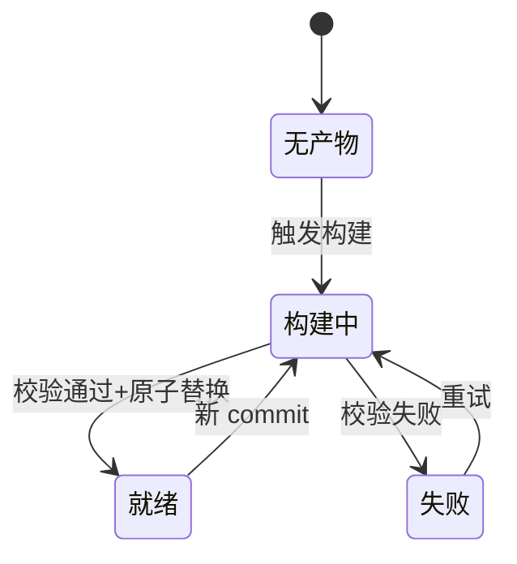

# 文档平台部署与多仓库管理（deployer）

> 状态：设计中 ｜ 负责人：Fanki ｜ 创建：2026-10-09
>
> **2026-10-14 统一模型修订（已落地，取代本文以下条目）**：读者面/运维面分离。
> ① **R2/R3 挂载模型改写**：多仓库**并存浏览**——`/` = 壳渲染的仓库列表首页（门户页退场，`/_` 301 到首页）；`/<slug>/<文档>?branch=<分支>` 每仓独立 URL，任何人免凭证；「挂载指针」退化为默认分支的选择（`/api/tree|search-index` 无参时的回退）。运维面独立为 `/_/ops` 页（token + 全部管理操作），文档页内面板已删除。
> ② **R4/R5/R10 分支模型扩展**：白名单规则在**远端 refs 上展开**——远端新增且命中规则的分支自动建树+首轮索引；远端删除/不再命中的分支自动清工作树清产物+挂载指针收口；fetch 失败不清理（防误删在线内容）。更新语义不变（fetch + reset --hard）。
> ③ 同步时间按仓库记录（`/data/sync/<slug>.json`：仓库级 fetch 时间 + 每分支索引时间），读者面可见；fetch 失败留痕展示。
> ④ 分支切换 = 读者视角（?branch= 查询参数，只对自己生效），运维页不做「切换展示分支」——`switch` 动作改名「设为默认」。
> 实现细节以代码与各 ADR 为准；本文余下条目除上述修订外仍然有效。

## 一、功能定位

**一句话**：给 docvi 配一个容器化的部署编排服务（deployer）——容器即文档站：注入 git 凭证后开箱即用，在页面上添加仓库、按分支白名单自动拉取与构建、随时切换正在展示的分支，全程不需要登录服务器。

**用户价值**：团队部署一个镜像 + 挂一份卷就拥有「push 即生效」的自更新文档站；写文档的人不感知部署；运维操作（切分支、拉取、重建、排错）全部在页面完成，失败原因页面可见。

**术语**：

- **deployer**：本功能的编排服务（git 操作 + 构建队列 + 运维 API + 静态产物服务）；
- **工作树（worktree）**：git worktree，本文中一律指**检出 `origin/<分支>` 引用的 detached 工作树**——服务器不持有本地分支；
- **白名单分支**：仓库配置里声明要自动管理（建工作树、自动拉取、构建）的分支集合；
- **产物（release）**：一个「仓库 × 分支」的发布目录——自研壳零编译口径：正文 `.md` 原文 + 刷新出的 `tree.json` / `search-index.json`，平台上可挂载的唯一单元；
- **门户**：deployer 渲染的仓库选择页，平台的首页；
- **粘贴配置**：添加/编辑仓库时粘贴的 docs.config.yaml 全文，优先级高于仓库自带的同名文件。

## 二、业务规则

- **R1 容器形态**：单容器单进程——deployer 同时承担「git/构建编排、运维 API、静态产物服务」；nginx 仅作可选前置（统一网关/TLS 时）。git 凭证由部署方以 secret/env 注入，容器启动时装配为 git credential helper：**不入镜像层、不写配置文件、任何 API 不回显**。
- **R2 仓库模型**：平台可配置多个 git 仓库，每仓元数据 = `{ slug, 显示名, 远端 url, 分支白名单, 自动化覆盖, 粘贴配置 }`；`slug` 为 URL 与磁盘目录标识，限 `[a-z0-9-]`。首页 = 门户（仓库选择页）。
- **R3 挂载模型（v1）**：根路径同一时刻只挂载**一个「仓库 × 分支」的产物**——仓库级、分支级两级互斥，切换 = 原子改挂载指针。`/_` 前缀为 deployer 保留路径（门户等自身页面）；未挂载任何仓库时根路径跳门户；文档站 header「首页」链到门户。
- **R4 分支模型**：分支集合由白名单声明（精确名 + 通配，如 `main`、`1.*`），**不用「远端有几个就管几个」**——防止他人临时分支自动消耗构建资源。每个白名单分支一个 detached 工作树。
- **R5 更新语义**：更新 = `git fetch` + `git reset --hard origin/<分支>`。服务器对仓库**只读不写**（零本地提交），因此不存在合并 / 变基 / 冲突；分支被强推后更新即与云端对齐——「一切以云端为准」是结构保证而非错误处理。
- **R6 构建管线（自研壳迁移后为索引管线）**：对工作树内容根执行索引刷新——生成 `tree.json` + `search-index.json`（壳零编译、正文 `.md` 原文直出）→ 原子写入该分支发布目录。**任何情况下不做 in-place 重建**；索引失败不触碰已有发布文件，读者继续看到上一版。
- **R7 构建队列**：全局串行（并发度 1）；按（仓库, 分支）去重，排队中同分支的新目标覆盖旧目标（只构建最新 commit）。
- **R8 触发与自动化**：三个触发源——webhook（每仓库唯一 URL，含 secret）、面板手动、可配置的轮询 fetch。「自动 fetch / 新 commit 自动 build / 清理周期」全部可配：全局默认 + 仓库覆盖（继承模型）。**缺省 poll（300s 周期）**——单机/局域网部署开箱即自动同步。**webhook 是纯被动接收端**：平台只在 `/api/webhooks/:slug` 收推送，不会向 Git 平台自动注册——推送地址（面板展示、含 secret）需在仓库侧手工配置，且 Git 平台必须能主动访问到本平台（局域网部署常不满足，此时用 poll）。
- **R9 内容配置双源**：仓库自带 `docs.config.yaml`（本地开发用它）与平台粘贴配置并存，**粘贴优先**——构建时写入工作区根覆盖。粘贴配置校验：出现绝对路径直接拒绝（必须假设本地也能用同一份跑）；本地实时预览场景永远读仓库自带文件，两边互不影响。
- **R10 清理**：定期清理「白名单外」的工作树与产物；白名单内分支即使远端暂时删除也保留，等声明变化后再处理。
- **R11 移除仓库**：清该仓全部工作树、产物、配置项与 webhook；面板二次确认（后果文案写明「产物与工作树不可恢复」）。git 主库对象保留，GC 手动。
- **R12 鉴权**：运维 API 与面板要求 token（`OPS_TOKEN` 注入，面板首次访问输入一次存本地）（待拍板：默认 token 生成与轮换策略）；门户与文档站公开。SSO / 多用户留作后续（待拍板）。
- **R13 审计**：全部写操作（配置变更、切分支、更新、移除、手动构建）记审计日志：token 标识、时间、动作、参数摘要。
- **R14 状态可见**：每分支实时状态 = `{ 本地 commit、远端 commit、落后 N、产物状态 }`；构建日志保留尾段（≥ 200 行）供面板直接查看——排错不出浏览器。
- **R15 平台升级**：升级 = 换镜像重启（`compose pull && up -d`），不支持容器内原地改代码。构建记录记 `platformVersion`；启动与面板对比当前镜像版本，对旧平台产物提示「平台已更新」，支持一键全部重建（串行队列逐个原子替换，期间旧产物继续以旧本体服务）。单容器重启存在秒级访问间隙（静态服务随容器走），平台升级低频，接受为 v1 取舍（待拍板：需零间隙时前置常驻网关或双容器蓝绿）。
- **R16 持久化口径**：卷上保留的是「状态」而非「构建缓存」——git 主库（fetch 增量）、工作树（reset 增量）、产物（持续服务）；索引刷新是毫秒级纯文本操作、无持久缓存，容器层内无值得保留的东西，镜像自带平台依赖、构建不装包。

## 三、流程与状态机

添加仓库（主流程）：

```mermaid
flow LR
  A[门户添加仓库] --> B[clone 主库+探测 docs.config.yaml]
  B --> C[白名单分支建 detached 工作树]
  C --> D[入串行队列构建]
  D --> E{产物校验}
  E -- 通过 --> F[原子替换+上架可挂载]
  E -- 失败 --> G[记录失败+日志尾段]
```

自动更新（webhook / 轮询 / 手动共用）：

```mermaid
flow LR
  A[触发] --> B[git fetch]
  B --> C{白名单分支落后?}
  C -- 是 --> D[reset --hard origin/分支]
  D --> E[入构建队列]
  C -- 否 --> F[仅刷新状态]
```

产物状态机（「构建中」期间旧产物持续服务是硬约束）：



## 四、权限与边界

| 角色                   | 能做什么                                                                       |
| ---------------------- | ------------------------------------------------------------------------------ |
| 读者（内网）           | 浏览门户与文档站，无任何写操作                                                 |
| 运维者（持 OPS_TOKEN） | 面板全部操作：增删仓库、改配置、切仓库/分支、fetch/更新/构建、看构建日志与审计 |
| 部署者                 | 注入凭证与环境变量、挂载卷；不通过面板交互                                     |

**边界**：deployer 不做内容编辑（服务器对仓库只读，git 只进不出，不支持 push）；不做用户体系（v1 单 token）；不做全文检索之外的平台功能。与 docvi 平台的分工：**平台管「怎么渲染」，deployer 管「渲染哪份产物」**。

## 五、数据设计

无数据库——持久化 = 卷上目录 + 单个 YAML 配置 + 构建记录文件，容器重建后从卷恢复全部状态。磁盘布局：

```text
/data
├── config.yaml              # 全局配置 + 仓库配置（两层继承）
├── git/<slug>.git           # 每仓一个 bare 主库（对象共享）
├── worktrees/<slug>/<分支>/  # detached 工作树（reset --hard 的作用对象）
├── releases/<slug>/<分支>/    # 产物（current 由构建原子替换；挂载指针指向它）
├── builds/<id>.log          # 构建日志（记录 json 元数据 + 日志尾段）
└── audit.log                # 审计日志
```

配置结构（设计态，以实现代码为准）：

<script setup>
const configTables = [
  {
    name: '全局配置',
    cn: '全局配置',
    note: '仓库未显式覆盖的字段以此层为准；面板可视化编辑，写回即审计',
    fields: [
      { name: 'autoFetch', cn: '自动同步', type: "'webhook' | 'poll' | 'off'", key: '', note: '缺省 poll（fetchIntervalSec 周期同步，单机/局域网开箱即用）；webhook 用于接入推送；off 则仅手动' },
      { name: 'fetchIntervalSec', cn: '轮询间隔', type: 'number', key: '', note: 'poll 模式的 fetch 周期，缺省 300' },
      { name: 'autoBuild', cn: '自动构建', type: 'boolean', key: '', note: 'fetch 后发现新 commit 是否自动入构建队列' },
      { name: 'buildConcurrency', cn: '构建并发', type: 'number', key: '', note: 'v1 恒为 1（全局串行），字段保留为升级位' },
      { name: 'cleanupCron', cn: '清理周期', type: 'string', key: '', note: '白名单外工作树与产物的定期清理计划' },
      { name: 'logTailLines', cn: '日志尾段', type: 'number', key: '', note: '构建日志保留尾行数，缺省 200' },
    ],
  },
  {
    name: '仓库配置',
    cn: '仓库配置',
    note: 'config.yaml 的 repos[] 数组项；slug 唯一',
    fields: [
      { name: 'slug', cn: '仓库标识', type: 'string', key: 'UK', note: "URL 与磁盘目录标识，限 [a-z0-9-]" },
      { name: 'name', cn: '显示名', type: 'string', key: '', note: '门户卡片与面板展示名' },
      { name: 'url', cn: '远端地址', type: 'string', key: '', note: 'git 远端；凭证走容器内 credential helper，不写进 url' },
      { name: 'branches', cn: '分支白名单', type: 'string[]', key: '', note: '精确名 + 通配（如 main、1.*）；空数组视为仅 main' },
      { name: 'autoFetch', cn: '自动同步覆盖', type: "inherit | 'webhook' | 'poll' | 'off'", key: '', note: '缺省 inherit 继承全局' },
      { name: 'autoBuild', cn: '自动构建覆盖', type: 'inherit | boolean', key: '', note: '缺省 inherit 继承全局' },
      { name: 'contentOverride', cn: '粘贴配置', type: 'string | null', key: '', note: 'docs.config.yaml 全文；构建时写入工作区根覆盖仓库自带，绝对路径校验拒绝' },
    ],
  },
  {
    name: '构建记录',
    cn: '构建记录',
    note: '每次构建一条 json 元数据 + 同名 log；面板按仓库/分支倒序查询',
    fields: [
      { name: 'id', cn: '构建 ID', type: 'string', key: 'PK', note: '时间戳+随机后缀' },
      { name: 'repo / branch', cn: '归属', type: 'string', key: '', note: '仓库 slug 与分支名' },
      { name: 'commit', cn: '目标提交', type: 'string', key: '', note: '构建时工作树 HEAD 短 sha' },
      { name: 'trigger', cn: '触发源', type: "'webhook' | 'manual' | 'poll' | 'switch'", key: '', note: 'switch = 切分支导致的按需构建' },
      { name: 'status', cn: '状态', type: "'running' | 'success' | 'failed'", key: '', note: '失败时面板展示 log 尾段' },
      { name: 'durationMs', cn: '耗时', type: 'number', key: '', note: '供估算构建时长' },
      { name: 'platformVersion', cn: '平台版本', type: 'string', key: '', note: '构建时的镜像版本；与当前镜像不一致 = 旧平台产物，面板提示重建' },
    ],
  },
]
</script>

<TableTabs title="deployer 配置存储结构（设计态）" :tables="configTables" />

## 六、接口设计

deployer REST API，同源挂在 `/api`；权限门槛两种：**公开**（门户/文档站访问）与 **OPS_TOKEN**（运维操作）。以下为设计态契约承诺，完整 schema 以实现代码为准。

<script setup>
const opsEndpoints = [
  {
    method: 'GET',
    path: '/api/health',
    summary: '存活探针：当前挂载的仓库/分支与队列占用',
    auth: '公开',
  },
  {
    method: 'GET',
    path: '/api/repos',
    summary: '仓库列表：元数据 + 各分支状态（本地/远端 commit、落后 N、产物状态）',
    auth: 'OPS_TOKEN',
    response: [
      { name: 'repos', type: 'RepoSummary[]', desc: '含 branches[] 状态与当前挂载标记' },
    ],
    invariants: ['不返回 git 凭证、完整环境变量等敏感值'],
  },
  {
    method: 'POST',
    path: '/api/repos',
    summary: '添加仓库：clone → 探测仓库自带 docs.config.yaml → 建白名单工作树 → 首轮构建',
    auth: 'OPS_TOKEN',
    params: [
      { name: 'slug', in: 'body', type: 'string', required: true, desc: "[a-z0-9-]，唯一" },
      { name: 'name', in: 'body', type: 'string', required: true, desc: '门户显示名' },
      { name: 'url', in: 'body', type: 'string', required: true, desc: 'git 远端地址' },
      { name: 'branches', in: 'body', type: 'string[]', desc: '白名单，缺省 [main]' },
      { name: 'contentOverride', in: 'body', type: 'string', desc: '粘贴配置全文；含绝对路径时 422 拒绝' },
    ],
    invariants: [
      '克隆失败（地址/凭证）时仓库标记为异常，不产生部分工作树',
      { statement: 'slug 冲突直接拒绝，不做覆盖', kind: 'must-not' },
    ],
  },
  {
    method: 'PATCH',
    path: '/api/repos/:slug',
    summary: '编辑仓库：改名 / 调整白名单 / 更新粘贴配置 / 自动化覆盖（配置变更进审计）',
    auth: 'OPS_TOKEN',
    invariants: ['白名单收缩只清工作树与产物，不动主库对象'],
  },
  {
    method: 'DELETE',
    path: '/api/repos/:slug',
    summary: '移除仓库：清工作树 + 产物 + 配置 + webhook（幂等；二次确认由面板承担）',
    auth: 'OPS_TOKEN',
  },
  {
    method: 'POST',
    path: '/api/repos/:slug/fetch',
    summary: 'fetch：刷新远端引用与落后计数，不构建',
    auth: 'OPS_TOKEN',
  },
  {
    method: 'POST',
    path: '/api/repos/:slug/sync',
    summary: '同步（面板主操作）：fetch + 全部生效分支对齐远端（落后入索引队列），并补建索引落后分支（产物缺失 / 产物 commit 落后工作树）',
    auth: 'OPS_TOKEN',
    invariants: ['补建仅针对无正在运行任务的分支；已就绪且 commit 一致的分支不动'],
  },
  {
    method: 'POST',
    path: '/api/repos/:slug/branches/:branch/update',
    summary: '更新（API 保留）：fetch + reset --hard origin/<分支> + 落后时入构建队列',
    auth: 'OPS_TOKEN',
    invariants: [
      'reset 仅作用于 detached 工作树，永不作用于主库',
      '工作树脏（不应发生）时先 reset --hard 丢弃，保证以云端为准',
    ],
  },
  {
    method: 'POST',
    path: '/api/repos/:slug/branches/:branch/build',
    summary: '手动构建：按当前 HEAD 入构建队列（去重合并同分支排队任务）',
    auth: 'OPS_TOKEN',
  },
  {
    method: 'POST',
    path: '/api/repos/:slug/switch',
    summary: '切换展示分支/仓库：产物就绪 → 原子换挂载指针立即生效；未就绪 → 排队构建，面板轮询至完成',
    auth: 'OPS_TOKEN',
    params: [
      { name: 'branch', in: 'body', type: 'string', required: true, desc: '目标分支' },
    ],
    invariants: [
      { statement: '切换与构建失败不得使当前在线产物下线', kind: 'must-not' },
    ],
  },
  {
    method: 'GET',
    path: '/api/repos/:slug/builds',
    summary: '构建记录倒序分页（状态/耗时/触发源）',
    auth: 'OPS_TOKEN',
  },
  {
    method: 'GET',
    path: '/api/builds/:id/log',
    summary: '构建日志尾段（≥200 行），失败排错入口',
    auth: 'OPS_TOKEN',
  },
  {
    method: 'GET',
    path: '/api/config',
    summary: '读全局配置（面板配置页回显）',
    auth: 'OPS_TOKEN',
  },
  {
    method: 'PUT',
    path: '/api/config',
    summary: '写全局配置：写回卷上 config.yaml + 审计 + 热加载',
    auth: 'OPS_TOKEN',
  },
  {
    method: 'POST',
    path: '/api/webhooks/:slug',
    summary: 'push 事件接收：校验 secret → fetch → 白名单内落后分支按自动构建策略处理',
    auth: '仓库侧 secret',
    invariants: ['secret 不匹配返回 404（不暴露仓库存在性）'],
  },
]
</script>

<EndpointList title="deployer 运维 API（设计态）" :endpoints="opsEndpoints" />

## 七、设计取舍

<script setup>
const designDecisions = [
  {
    decision: '产物自包含——平台本体随每次构建打进去，放弃本体/内容分离构建',
    reason: 'VitePress 没有分离构建，共享运行时要破坏其哈希资产模型。自包含换来：产物永远按构建时的平台版本渲染、平台升级不污染已有产物、回滚 = 切回旧产物。代价是平台升级后需重建产物——用构建记录的 platformVersion + 一键全部重建消化。',
    kind: 'why',
  },
  {
    decision: 'build + 原子切换，放弃 dev 常驻热更新',
    reason: 'dev 热更新只对小幅变更稳；切分支是几千文件的批量变更——watcher 风暴、缓存陈旧、半更新状态，且 dev 进程不适合生产（内存无界、错误暴露）。原子切换把稳定性变成结构保证：构建再久、失败与否，旧产物始终在线。',
    evidence: '平台仓实测：in-place 重建 dist 曾把运行中的服务直接打崩（ENOENT）；dev 两层缓存坑在档案有案底',
    kind: 'why',
  },
  {
    decision: 'detached 工作树 + reset --hard，放弃本地分支 + pull --rebase',
    reason: '服务器对仓库只读、零本地提交，冲突只可能来自强推——那就让「以云端为准」成为结构：本地分支根本不存在，reset --hard 即更新，无需冲突处理路径。',
    kind: 'why',
  },
  {
    decision: '两级互斥挂载，放弃 v1 子路径并存',
    reason: '子路径要求按前缀注入 vitepress base，连带 docs.config.yaml 手写绝对链接全部要过 withBase——改造面大。v1 用「仓库×分支」两级指针切换得到同样的业务能力（选仓库→看分支），零平台改造；并存形态留 v1.2。',
    kind: 'why',
  },
  {
    decision: '单容器 Node 直服产物，放弃默认前置 nginx',
    reason: '产物是纯静态，Node 按请求解析路径对 symlink 切换即时生效，天然绕开 nginx open_file_cache 吐旧文件的坑；团队规模下性能足够。nginx 保留为可选前置（网关/TLS）。',
    kind: 'why',
  },
  {
    decision: '粘贴配置整份替换，放弃字段级合并',
    reason: '替换语义可预期、可导出回读；合并要为每个字段定义优先级，出错难排查。UI 用「从仓库导入」预填降低重写成本。',
    kind: 'why',
  },
  {
    decision: '分支白名单，放弃远端全量自动管理',
    reason: '「远端有几个管几个」会让任何人的临时 feature 分支自动消耗构建资源与磁盘；白名单 + 通配把资源边界交给配置。',
    kind: 'avoid',
  },
  {
    decision: '配置存卷上 YAML，放弃数据库',
    reason: '配置量级小、变更低频，YAML 可读可手修、容器重建零迁移；构建记录用 json 文件同理。',
    kind: 'why',
  },
]
</script>

<DecisionCard title="部署平台的关键设计决策" :decisions="designDecisions" />

## 八、验收标准

验证环境：本地 Docker（compose 起 deployer + 挂载卷 + 注入测试凭证与 OPS_TOKEN），对真实 git 远端验证。

- AC1 空容器启动：门户显示「添加仓库」引导，根路径跳门户，无已挂载产物时报错态友好（验证：人工）
- AC2 添加私有仓库：clone → 探测到仓库自带 docs.config.yaml 并预填 → 白名单分支工作树齐全 → 首轮构建成功 → 门户卡片变为「就绪」，进入可浏览（验证：人工 + 单测）
- AC3 push 新 commit 到展示分支：webhook 触发 fetch + reset + 构建 + 原子替换；全程对站点轮询 200（旧版本不中断），完成后内容更新（验证：人工 + 脚本）
- AC4 切分支：产物就绪的分支秒级切换；未就绪分支面板显示「构建中」，完成后可进入；期间旧分支持续可访问（验证：人工）
- AC5 强推分支后「更新」：本地 HEAD 与云端一致（sha 相同），无任何冲突提示路径（验证：人工）
- AC6 构建失败注入（破坏 yaml）：旧产物继续 200，面板显示失败状态 + 日志尾段可读，修复重试后恢复（验证：人工）
- AC7 粘贴配置覆盖：服务器展示粘贴的 title 而仓库文件未变；本地 `pnpm dev:docs <工作树>` 读仓库自带配置；绝对路径的粘贴配置被 422 拒绝（验证：人工 + 单测）
- AC8 移除仓库：工作树/产物/配置/webhook 清除，门户不再显示，磁盘占用回落（验证：人工）
- AC9 白名单外分支不建工作树不构建；把工作树目录手动塞进 worktrees 后清理任务能删掉它（验证：人工 + 单测）
- AC10 容器销毁重建（卷保留）：仓库/分支/产物/配置/审计全部恢复，无需重新添加（验证：人工）
- AC11 全部写操作在审计日志可查（操作者/时间/动作/参数摘要）（验证：单测）
- AC12 平台升级：pull 新镜像重启后，面板提示存在旧平台版本产物；一键重建全部成功后各产物 platformVersion 为新版本，重建期间站点持续可访问（仅容器重启瞬间有秒级间隙）（验证：人工）

## 九、前端设计

三个界面，两个归属：

1. **门户页**（deployer 渲染，不属于任何仓库的构建物）：仓库卡片（显示名 / slug / 分支摘要 / 产物状态 / 当前挂载标记）+「添加仓库」入口；空态即引导页；`/_` 保留前缀下提供。
2. **运维面板**（docvi 主题组件，构建时配置门控——不开则完全不打包交互）：文档站 header「首页」旁按钮 → 弹层。分区：分支列表（每行状态徽章 + 落后 N + 更新/构建按钮）、切换仓库/分支、构建记录与日志查看、配置页入口。API 走同源 `/api`（无 CORS）；token 首次输入存本地。
3. **配置页**（面板内的 tab）：全局配置表单 + 仓库列表（增删改、粘贴配置编辑器带「从仓库导入」与相对路径校验提示）。

平台侧改造点清单：

- 新增主题组件「运维面板 + header 按钮」（门控），复用现有组件体系与样式 token；
- `docs.config.yaml` 加载层补粘贴配置的绝对路径校验（现协议天然相对路径，补防线）；
- `run-docs build <任意目录>` 已支持工作树构建，**零改造**；
- 子路径并存（v1.2）时再引入 base 注入与 withBase 链接治理，本文不展开。

## 十、关联文档

- [组件协议](../architecture/组件协议.md)——面板/门户复用的组件体系与数据协议
- 组件活参考：`courses/component-showcase`（内建组件清单，面板实现对照）
- [README 快速开始](../../README.md)——三形态启动；deployer 构建即 `run-docs build <工作树>`（standalone 形态）
- 规范来源：本文结构与验收标准（随实现演进）
