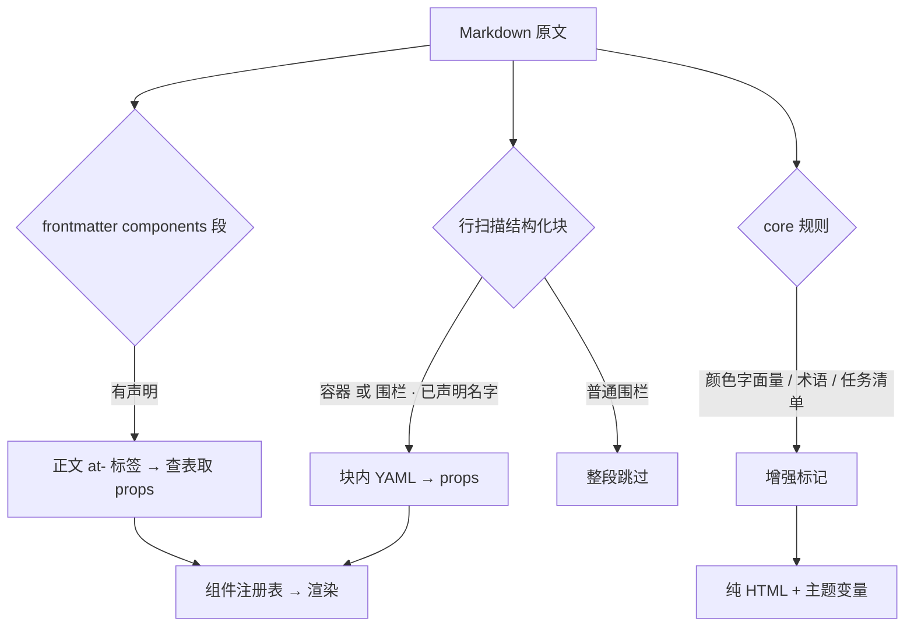

# 文档语法分层与渲染增强

> 状态：部分实施（第一档为主线的定位已由 ADR-0006 确立；`^` 合并语法未实施，且**不再是优先项**）｜ 负责人：Fanki ｜ 创建：2026-10-24 ｜ 最近修订：2026-11-12
>
> 上位文档：[ADR-0006 原生 Markdown 优先](../architecture/adr/0006-native-markdown-first.md)、[docvi 目标架构与实施总案](./docvi目标架构与实施总案.md)
>
> ⚠️ **ADR-0006 之后本文件的定位变了**：三档不再是并列关系。第一档（原生语法 / 通用扩展的渲染优化）是**主线**，第二、三档是**可选项**，且第三档带明确的可移植性代价。本文其余章节描述的是实现机制，不是推荐顺序。

## 一、功能定位

**一句话**：把「Markdown 里的增强」按**可移植性**分成三档，明确哪一档值得持续投入。

**判据只有一条**：这段内容离开 docvi 之后还要不要能读。

- **能读**（原生语法、GFM、mermaid、通用容器）→ 做视觉优化，投入不设上限。退化后仍然是正确的内容。
- **不能读**（自定义标签、块内 YAML）→ 保留能力，但不作为默认表达，也不再扩展。

**用户价值**：作者写字时不用猜「这算插件还是算主题」，也不该在写一篇普通文档时被迫学习一套只有 docvi 认识的协议。

**术语**：

- **渲染增强**：不改变文档语义，只改变同一段文字的画法（如把 `#ff0000` 加上色块）。
- **结构化块**：块内是 YAML 而非 Markdown，必须由组件渲染才有意义（如流程图节点表）。
- **约定式语法**：用 Markdown 原生语法承载结构信息，不引入新围栏（如用 `^` 表示合并）。

## 二、业务规则

**R1｜三档以「可移植性」排序，不并列**

| 档             | 判据                                         | 表达通道                                          | 定位               |
| -------------- | -------------------------------------------- | ------------------------------------------------- | ------------------ |
| 一、渲染增强   | 删掉增强后同一段文字仍通顺，且**别处也能读** | `renderer-core` core 规则 + frontmatter 开关      | **主线，持续投入** |
| 二、约定式语法 | 原生渲染会露出标记，但人读得懂               | 插件声明的行内/单元格标记                         | 可选，不再新增     |
| 三、结构化块   | 原生渲染后无法理解含义，**只有本平台能读**   | 插件声明的容器/围栏 + 块内 YAML，或 `<at-*>` 标签 | 可选，不推荐作默认 |

**R0｜判据的优先级高于档位本身**

档位只是描述现状，选型时直接问「离开 docvi 还能读吗」：

| 内容                               | 用什么                               | 备注                                |
| ---------------------------------- | ------------------------------------ | ----------------------------------- |
| 表格、清单、步骤、术语             | GFM 表格 / 任务清单 / 加粗段首       | 全部渲染器都认                      |
| 流程 / 时序 / 状态 / 表关系 / 拓扑 | ` ```mermaid ` 围栏                  | GitHub、飞书、VS Code 都渲染        |
| 提示、警告、折叠                   | `::: tip` 等容器 / `details`         | 退化后是普通引用块                  |
| 需要交互（点选、步进、字段锚定）   | 自定义组件                           | **只有 docvi 能渲染**，用前主动告知 |
| 任意图形 / 动效（画板级）          | HTML 岛（独立 `.html` 文件 + `src`） | 独立文件本身可移植，双击就能看      |

**R2｜第一档不进插件体系**

渲染增强不改语义、不需要数据块、误渲染风险低，做成插件只会让用户多装一次。已有的两个实例是行内代码颜色色块与术语块（`at_term_blocks`），都由 frontmatter 开关关闭（`colors: false` / `terms: false`）。

**R3｜第二档必须「删掉插件也读得懂」**

`^` 合并单元格这类标记，在未安装插件时必须以原样文本出现在表格里，而不是消失或报错。这是它与第三档的根本区别：**第二档的语法本身就是内容的一部分**，第三档的语法只是数据的容器。

> 注：R3 仍然成立，但 `^` 合并语法**不再是待实施的优先项**——合并单元格用 HTML `<table>` 或拆成两张表都能表达，收益不抵「又一种非标准写法」的成本。

**R4｜第三档必须显式声明，且两种围栏等价**

- `::: <名字>` 容器与 ` ```<名字> ` 围栏**完全等价**，数据都写在块内 YAML，都不占 frontmatter。
- 选择依据只有一条：围栏是通用 Markdown 语法（格式化工具与其它编辑器能原样保留），容器更短但换编辑器会露出裸 `:::`。
- 块内的根节点必须是 YAML 映射（不是数组）；不可解析时显示原文并报错，不静默丢弃。

**R5｜frontmatter + 标签是独立的第三档写法，不与围栏互斥**

数据量大的组件（流程图可达 18 节点以上、表关系图几十张表）用 frontmatter `components` 段 + 正文 `<at-kind data-key>` 引用，让正文保持一屏可读。它与容器/围栏**可以出现在同一篇文档里**：渲染管线是两条独立路径，各自扫各自的标记。

> 这条是实测确认的（2026-10-24）：同一篇文档同时含 frontmatter 声明、`::: merged` 容器与 ` ```chart ` 围栏时，三者全部渲染，「互不兼容」只对**单个组件**成立（同一组件的两种写法不能混用）。

**R6｜所有档位的配色只能引用主题变量**

插件与 core 规则都不允许写死颜色字面量。第一、二档由 core 规则直接产出 `at-*` 类名，样式在 `doc.css` 里用 `--dv-doc-*`；第三档的组件必须只用 `--dv-c-*` / `--dv-doc-*`。这样换主题时三档一起变，不会出现「插件自带一套配色」。

**R7｜扫描实现只有一份**

`packages/renderer-core/src/plugin-blocks.ts` 的 `findPluginBlocks` 是**唯一**的行扫描实现，阅读态、编辑态、导出、分享四条路径都调它。这些路径各写一份正则曾导致缩进两格的收尾 `:::` 在编辑态被识别、阅读态不认——同一篇文档两处长得不一样。

## 三、流程与状态机

阅读一篇文档时，四种标记按下面的顺序被认领：



## 四、权限与边界

| 角色     | 能做什么                                                                 |
| -------- | ------------------------------------------------------------------------ |
| 文档作者 | 使用任意档位的语法；不需要知道它属于哪一档                               |
| 插件作者 | 只能声明第二档（行内/单元格标记）与第三档（容器/围栏）；**不能**改第一档 |
| 平台     | 决定第一档有哪些、能否用 frontmatter 关闭                                |

**与相邻体系的区隔**：

- **不是主题**：主题管「已有的东西长什么样」，语法分层管「Markdown 表达不了的东西怎么表达」。颜色增强属于前者，合并单元格属于后者。
- **不是组件库**：组件（`plugins/base` 的 24 个）是第三档的实现手段，不是这套分层的定义。
- **不引入新围栏语法**：除 `:::` 与标准围栏外，不新增第三种围栏。第二档靠 Markdown 自身的行内与表格语法承载。

## 五、数据设计

本节无数据库表。涉及的数据形状只有两种声明，均落在插件清单里：

**结构化块声明（`contributes.markdownSyntax[]`）**

| 字段                    | 类型                     | 说明                                                  |
| ----------------------- | ------------------------ | ----------------------------------------------------- |
| `name`                  | string                   | 围栏语言名或容器名；必须与 `form` 匹配                |
| `form`                  | `'fence' \| 'container'` | 围栏形状；**缺省按 container 处理**（兼容老清单）     |
| `component`             | string                   | 目标组件 kind，须在 `contributes.components[]` 里存在 |
| `title` / `description` | LocalizedText            | 面板展示用                                            |

**frontmatter 声明（`components:` 段）**

| 键           | 说明                                             |
| ------------ | ------------------------------------------------ |
| `<任意键名>` | 正文 `data-key` 引用的名字；同名会叠加 `-2` 后缀 |
| `kind`       | 必填，决定渲染成哪个组件                         |
| 其余键       | 整体透传为组件 props（不认识的键忽略，不报错）   |

## 六、接口设计

**渲染管线入口（`@docvi/renderer-core`）**

| 导出                                               | 职责                                                                                           |
| -------------------------------------------------- | ---------------------------------------------------------------------------------------------- |
| `renderMarkdown(src, path, options)`               | frontmatter 解析 → 结构化块替换 → Markdown 渲染 → 大纲；`options.containerSyntax` 传入插件声明 |
| `findPluginBlocks(lines, syntax)`                  | **唯一**行扫描；返回 `{ startLine, endLine, body, name, component, form }`                     |
| `mountDeclarativeComponents(root, decl, registry)` | 按 `data-key` 挂载 frontmatter 声明的组件                                                      |
| `mountPluginBlocks(root, registry)`                | 按 `data-plugin-component` 挂载结构化块                                                        |

**占位元素契约**：结构化块被替换成

```html
<div
  class="at-plugin-block"
  data-plugin-syntax="<名字>"
  data-plugin-form="container|fence"
  data-plugin-component="<kind>"
  data-plugin-payload="<percent-encoded YAML>"
></div>
```

不变量：渲染管线**不认识任何具体插件**，只产出占位元素；组件挂载由宿主按 `data-plugin-component` 触发。

## 七、设计取舍

**D1｜为什么第二档不用「声明块」**

第二档的价值就是「源码本身可读」。再加一个声明块（如 `<!-- at: merge -->`）会同时破坏可读性与简洁性，而 `^` 这类标记本身已经无歧义。只有第三档需要声明——因为它的块内是 YAML，没有声明就无法与正文区分。

**D2｜为什么第一档不进插件**

判断标准是「用户是否需要为此做决定」。颜色色块是全体用户都会遇到、且不需要选择的增强；做成插件等于让每个新用户先装一次才有完整效果。反之，合并单元格只有写特定文档的人才需要，插件形态是合适的。

**D3｜为什么保留两种第三档围栏**

`::: merged` 更短、更像「一个块」；` ```chart ` 是通用 Markdown，会被格式化工具与其它编辑器原样保留。两种都保留是因为它们服务于不同场景，而共用同一份扫描与挂载实现，维护成本接近零。

**D4｜放弃：单一围栏语法**

曾考虑只保留一种、另一种标为废弃。否决理由：存量文档（`merged-table` 示例与已有 PRD）已经在用 `:::`；强行迁移的收益只是「少一种写法」，而代价是全部存量文档要改。

**D5｜放弃：让主题包承担渲染增强**

主题只能改颜色与字体，拿不到「这段文字是颜色字面量」这个语义。把颜色增强放进主题，意味着主题作者要实现一个 Markdown 解析器——职责错位。

## 八、验收标准

| 编号 | 验收项                                                          | 验证方式                      |
| ---- | --------------------------------------------------------------- | ----------------------------- |
| AC1  | 同一文档可同时含 frontmatter 声明、容器块、围栏块，三者全部渲染 | 单测 `plugin-blocks.test.mjs` |
| AC2  | 容器收尾标记缩进 0–3 格都能识别                                 | 单测                          |
| AC3  | 代码块内举例写的 `:::` 不被当成真块                             | 单测                          |
| AC4  | 未声明的名字留源码不渲染；未闭合的块不吃掉后续内容              | 单测                          |
| AC5  | CRLF 文档的块体无 `\r` 残留                                     | 单测                          |
| AC8  | 插件产物中不得出现颜色字面量                                    | 静态校验（待实施）            |

~~AC6 / AC7（`^` 合并语法）~~：按 ADR-0006 不再是优先项，不再排期。合并单元格用 HTML `<table>` 或拆表表达即可。

## 九、前端设计

**编辑态**：Live Preview 的块装饰与阅读态**共用**同一条渲染管线（`renderMarkdown`），块内容不在编辑器里另写渲染器。

**光标与块的交互分两类**：

| 块类型                         | 光标进入时   | 编辑入口                                           |
| ------------------------------ | ------------ | -------------------------------------------------- |
| 表格、mermaid                  | **保持渲染** | 点表格本体 → 网格编辑弹窗；双击 mermaid → 源码弹窗 |
| 代码块、组件卡片、插件结构化块 | 退回源码     | 直接在块内改                                       |

表格与 mermaid 豁免的理由：它们的源码形态与渲染形态**高度差极大**（6 列表格源码几十行 vs 渲染几行；mermaid 源码是代码 vs 渲染是 SVG），随光标展开会让整页跳一截再缩回去，而这两类块本来也不适合逐字符改。豁免的同时必须把它们登记为 `atomicRanges`（否则光标仍会落进看不见的源码行）并补上显式编辑入口。

**斜杠菜单**：富组件分组里的每一项按 `seed.form` 决定插入形态——容器插入 `::: name\n<YAML>\n:::`，围栏插入 ` ```name\n<YAML>\n``` `，frontmatter 形态插入 `<at-kind data-key>` 并同步写声明。

## 十、未实施项

按 ADR-0006 的判据（外部标准定的语法值得投入，自研的不扩展）排序，以下事项**有明确需求但目前没做**：

| 事项                                         | 为什么值得做                                        | 难点 / 已知约束                                                                                                       |
| -------------------------------------------- | --------------------------------------------------- | --------------------------------------------------------------------------------------------------------------------- |
| 从外部应用粘贴文件到 docvi（落盘到素材目录） | 用户从资源管理器 / 微信复制文件后应能直接粘进工作区 | 需主进程读剪贴板的 `text/uri-list`、跨盘移动、重名、目录递归、UI 落点判定；工作量明显大于「复制到外部」那半（已实现） |
| 代码块行号 + 单行高亮（`{1,3-5}`）           | 技术文档引用代码行是刚需，且该语法在 GitHub 上通用  | 与 shiki 高亮的行结构要对齐                                                                                           |

**已实施**（2026-11-12，本次）：

| 事项                           | 做法                                                                                                                      |
| ------------------------------ | ------------------------------------------------------------------------------------------------------------------------- |
| `text` 围栏不显示语言标签      | 语言标签只在 `info` 非空且不是 `text` 时渲染；复制按钮用 `:has()` 收回贴右                                                |
| ASCII 图（框线 + CJK）自动对齐 | 检测「含框线字符 + 同宽字符混排」→ 给容器打 `data-ascii`，宽字符包成 `inline-block: 2ch`；实测满宽行偏差 19.05px → 0.55px |

**明确不做**（全库用量为零或已被否）：数学公式（0 处）、脚注（0 处）、`^` 合并单元格语法、新增自定义渲染组件。

## 十一、关联文档

- [ADR-0006 原生 Markdown 优先](../architecture/adr/0006-native-markdown-first.md)（本文档的定位依据）
- [平台插件化与 AI 分发](./平台插件化与%20AI%20分发.md)（插件清单与协议）
- [docvi 目标架构与实施总案](./docvi目标架构与实施总案.md)（§7.3 渲染纪律）
- [平台自研壳与多宿主迁移](./平台自研壳与多宿主迁移.md)（壳的渲染路径）
