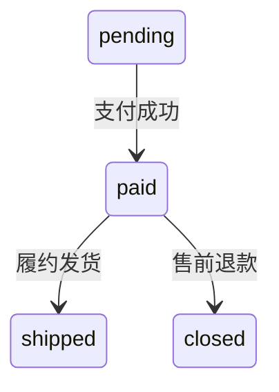

# 在 Markdown 里表达结构

> 真相源。写文档、做教学设计时先读本文；它规定了「什么内容用什么写法」，
> 以及为什么某些写法必须被放弃。

## 一条原则

**Markdown 原文就是成品。** 任何内容都不该依赖某个编辑器才能读懂——换 Obsidian、
Typora、GitHub、VS Code 打开，凡是文档里写了的东西都应该看得见。

这条原则排除了「用自定义标签表达内容」的原因很简单：`<at-flow-diagram data-key="x">`
在别处就是一行无意义的标签，真正的数据还锁在 frontmatter 里。读者换工具就丢内容，
作者换工具就写不了。

## 五种写法，覆盖全部需求

| 要表达的东西                | 用什么                                       | 例子 |
| --------------------------- | -------------------------------------------- | ---- |
| 流程 / 状态机 / 时序 / 关系 | `mermaid` 围栏                               | 见下 |
| 字段、参数、对比、清单      | 标准 Markdown 表格                           | 见下 |
| 折叠、强调、分栏等版式      | 原生 HTML（`<details>` / `<div>` / `<kbd>`） | 见下 |
| 需要交互的图解              | 独立 `.html` 文件 + `<iframe sandbox>`       | 见下 |
| 数学公式                    | `$…$` 行内 / 行首 `$$…$$` 成块（TeX）        | 见下 |

### 流程图与状态机

````markdown

````

### 字段表

```markdown
| 字段     | 中文名 | 类型    | 约束 | 说明                          |
| -------- | ------ | ------- | ---- | ----------------------------- |
| `id`     | 主键   | bigint  | PK   |                               |
| `status` | 状态   | varchar | 必填 | `PENDING` / `PAID` / `CLOSED` |
```

### 折叠块（原生 HTML，几乎所有渲染器都支持）

```html
<details>
  <summary>点开看完整参数</summary>

  正文可以是任意 Markdown。
</details>
```

### 交互式图解（iframe）

把图解写成一个自包含的 `.html`（内联 CSS/JS、零外部请求），与文档放在同一目录：

```html
<iframe src="./demo.html" sandbox="allow-scripts" height="420"></iframe>
```

`src` 支持相对路径（按文档所在目录解析），也支持 `https://` 外链。
`height` 建议显式给出——iframe 缺省高度只有 150px，图解会被压成一条缝。

### 数学公式（TeX）

行内用单个美元，独占一块用行首的双美元：

```markdown
预读稳定维持在 $W/4$（约 30 帧 / 1 秒）。

$$
\frac{a+b}{c} = \sqrt{x^2 + y^2}
$$
```

- 解析器是 KaTeX，输出 **MathML**（浏览器原生排版），不依赖字体文件与控制台警告；
- 支持 `aligned` 等多行环境，块级公式在窄屏上横向滚动而不是折行；
- 解析失败会标红并**保留源码**，不会白屏；
- `\$` 是字面美元；`$5 到 $10` 这种货币写法不会被误认成公式（判据：开定界符后不能是空格/`$`，闭定界符前不能是空格、前后不能紧邻 `$`、闭定界符后不能紧跟数字）；
- 安全：`\href{javascript:…}` 这类命令在 `trust: false` 下不会产出可点击链接。

## 为什么交互式图解要放进 iframe

应用入口页带 CSP：`script-src 'self'`。这意味着**正文里直接写的 `<script>` 不会执行**——
这是安全边界，不是限制：文档是可以从任何地方下载来的，能执行任意脚本等于把整台机器交出去。

iframe 走的是另一条策略（`frame-src`，未单独声明时回退 `default-src`，已含 `docvi:`）。
`sandbox="allow-scripts"` 让子文档里的脚本能跑，同时**拿不到**父页的 DOM、localStorage、
cookie——图解能交互，但读不到你的数据。

因此：

- 需要动画/交互 → 写独立 html + iframe
- 只是静态版式 → 原生 HTML 标签就够
- 不需要交互的图 → mermaid 优先（源码可 diff、可被 AI 改）

## 不要做什么

| 反模式                                 | 为什么                                            |
| -------------------------------------- | ------------------------------------------------- |
| 自定义标签（`<at-*>`)                  | 换个编辑器就丢内容；数据锁在 frontmatter 里不可读 |
| `<script setup>` / `<script>` 写在正文 | CSP 拦掉，永远不执行；读者会以为文档坏了          |
| 把图导出成 png 再贴进来                | 改图要重新导出，图与正文迟早不一致                |
| 用 HTML 表格替代 Markdown 表格         | 失去 diff 可读性，且无必要                        |

## 历史：组件系统已退役

2026-10 曾引入一套自定义标签组件（`<at-*>`) 表达表关系、接口清单、决策卡等，
数据放在 frontmatter。它的问题在 2026-11 暴露：文档只能在本平台读，且这些内容
本来就能用 mermaid + 表格表达。

2026-11-24 起：

- 新文档一律用上面的五种写法，**不写 `<at-*>`)；
- 旧文档保留原样（插件代码仍在仓库，从安装包移出），不做强制迁移；
- `plugins/` 作为历史兼容保留，不再新增组件。

相关决策见 `docs/architecture/adr/`。
