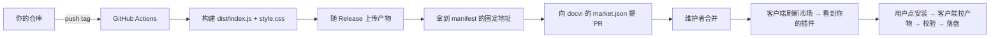

# 插件市场接入指南

面向想把自己的插件放进 docvi 插件市场的人。读完这份文档你能做到：让插件出现在市场的
「可安装」列表里，并且用户点一下就能装进客户端。

**核心约定：产物由你的仓库构建，客户端只负责下载和校验。** docvi 不构建第三方代码，
也不下载整个仓库或压缩包——它按清单给出的地址逐个取文件。这条约定决定了下面所有规范。

- [一、整体流程](#一整体流程)
- [二、插件包要满足什么](#二插件包要满足什么)
- [三、让 GitHub Actions 产出可安装的产物](#三让-github-actions-产出可安装的产物)
- [四、向市场清单提 PR](#四向市场清单提-pr)
- [五、清单字段完整说明](#五清单字段完整说明)
- [六、客户端如何校验你的产物](#六客户端如何校验你的产物)
- [七、常见问题](#七常见问题)

---

## 一、整体流程



要点：

1. **产物地址必须长期稳定**。用 Release 资产地址或固定分支的 raw 地址，不要用
   「每次构建都变的临时链接」——清单里的地址是写死的。
2. **版本号要能区分**。清单里的 `version`、你仓库 `plugin.json` 里的 `version`、
   产物地址指向的那一版，三者必须一致。
3. **不需要打包成压缩包**。客户端没有解压能力，见第二节。

## 二、插件包要满足什么

插件本身是一个目录，最少两个文件：

```
plugin.json       必须 —— 清单
dist/index.js     必须 —— ESM 入口，external: vue
dist/style.css    可选 —— 零到多个，在 manifest 的 styles 里声明
```

`plugin.json` 的最小可用形状：

```json
{
  "name": "docs-plugin-audio",
  "displayName": { "zh": "音频组件包", "en": "Audio Pack" },
  "version": "0.1.0",
  "apiVersion": "1",
  "trust": "presentation",
  "description": { "zh": "音频波形与区间标注", "en": "Waveform and range annotation" },
  "entry": "dist/index.js",
  "styles": ["dist/style.css"],
  "repository": "https://github.com/you/docs-plugin-audio",
  "license": "MIT"
}
```

字段约束（客户端会逐项校验，任一条不满足即拒绝安装）：

| 字段             | 要求                                                                                              |
| ---------------- | ------------------------------------------------------------------------------------------------- |
| `name`           | 只允许小写字母、数字、短横；全局唯一。建议带组织前缀（`acme-plugin-foo`）                         |
| `version`        | 合法 semver；必须与市场清单里的 `version` 完全一致                                                |
| `apiVersion`     | 主版本必须等于宿主 API 版本（当前为 `1`）                                                         |
| `displayName.zh` | 必填，非空字符串                                                                                  |
| `trust`          | `presentation`（默认，仅页面呈现）/ `sandbox-service` / `trusted-service`。**漏写按最低权限处理** |
| `entry`          | 包内相对路径，不许含 `..`、不许是绝对路径，不许含冒号                                             |
| `styles`         | 同上，数组                                                                                        |

`trust` 是用户在安装时唯一能看到的权限提示，请如实声明。判断标准：

- 只渲染 Markdown 里的内容、不读文件、不联网 → `presentation`
- 需要读本地目录或发起网络请求 → `sandbox-service`（独立 worker，能力需显式授权）
- 需要完整 Node 能力（git、子进程） → `trusted-service`

组件的声明方式、`kind` 命名、Vue 版本约束等协议细节见
[平台插件化与 AI 分发](./design/平台插件化与%20AI%20分发.md) 的「插件包协议」一节。

## 三、让 GitHub Actions 产出可安装的产物

客户端要的只是一串能直接 HTTP GET 的文本文件。推荐把它们作为 Release 资产发布，
这样地址稳定、带版本号、也方便你回溯。

`.github/workflows/release.yml`：

```yaml
name: release

on:
  push:
    tags: ['v*']

permissions:
  contents: write

jobs:
  build:
    runs-on: ubuntu-latest
    steps:
      - uses: actions/checkout@v4
      - uses: actions/setup-node@v4
        with:
          node-version: 22
      - run: npm ci
      - run: npm run build # 产出 dist/index.js 与 dist/style.css

      # 关键：把 plugin.json 的 version 改成 tag 的版本，避免两处漂移
      - run: |
          node -e "
            const fs = require('fs')
            const version = process.env.GITHUB_REF_NAME.replace(/^v/, '')
            const manifest = JSON.parse(fs.readFileSync('plugin.json', 'utf8'))
            manifest.version = version
            fs.writeFileSync('plugin.json', JSON.stringify(manifest, null, 2) + '\n')
          "

      # 把 manifest 的哈希算出来——填进市场清单能防篡改，强烈建议
      - run: node -e "
          const crypto = require('crypto')
          const fs = require('fs')
          const hash = crypto.createHash('sha256').update(fs.readFileSync('plugin.json')).digest('hex')
          console.log('manifest sha256:', hash)
          fs.writeFileSync('manifest.sha256', hash)
        "

      - uses: softprops/action-gh-release@v2
        with:
          files: |
            plugin.json
            dist/index.js
            dist/style.css
```

发布后你会得到形如下的固定地址（把版本号换掉即可用到清单里）：

```
https://github.com/you/docs-plugin-audio/releases/download/v0.1.0/plugin.json
https://github.com/you/docs-plugin-audio/releases/download/v0.1.0/dist/index.js
https://github.com/you/docs-plugin-audio/releases/download/v0.1.0/dist/style.css
```

清单里**只填 `plugin.json` 的地址**；其余文件由客户端从 manifest 的 `entry` / `styles`
推出——它们与你 manifest 同目录结构，客户端会按相对路径解析。

> 也可以用 `raw.githubusercontent.com` 指向某个固定 tag：
> `https://raw.githubusercontent.com/you/docs-plugin-audio/v0.1.0/plugin.json`。
> 两者都行，Release 资产的好处是不会被后续提交影响。

## 四、向市场清单提 PR

清单文件是仓库里的 [`plugins/market.json`](../plugins/market.json)。上架就是往
`plugins` 数组里**追加一项**，然后提 PR。

1. Fork [docvi 仓库](https://github.com/OneFanki/docvi)
2. 编辑 `plugins/market.json`，在 `plugins` 数组末尾追加你的条目
3. 提交 PR，标题写 `feat(market): 上架 <你的插件名>`
4. PR 描述里附上：插件仓库地址、产物地址、一句话说明它能做什么

维护者合并后，客户端下次刷新市场（打开插件面板会自动刷新，也可以点「刷新」）就能看到。

追加的条目长这样：

```json
{
  "name": "docs-plugin-audio",
  "displayName": { "zh": "音频组件包", "en": "Audio Pack" },
  "version": "0.1.0",
  "description": { "zh": "音频波形与区间标注", "en": "Waveform and range annotation" },
  "trust": "presentation",
  "tags": ["audio", "media"],
  "repository": "https://github.com/you/docs-plugin-audio",
  "artifact": {
    "manifest": "https://github.com/you/docs-plugin-audio/releases/download/v0.1.0/plugin.json",
    "sha256": "<上一步算出的 manifest sha256>"
  }
}
```

同时把顶层 `updatedAt` 改成你提 PR 的日期（`YYYY-MM-DD`）。

**提交前自查：**

- [ ] `name` / `version` 与产物里 `plugin.json` 完全一致
- [ ] `artifact.manifest` 是 https，且落在 GitHub 域（`github.com` / `githubusercontent.com`）
- [ ] `artifact.sha256` 与实际 manifest 文件的 SHA-256 一致
- [ ] `repository` 是公开仓库，能直接打开
- [ ] 本地用 `node -e "JSON.parse(require('fs').readFileSync('plugins/market.json','utf8'))"` 确认 JSON 合法

### 一个仓库维护多个插件（monorepo）

明确支持：**`name` 是全市场的唯一键，仓库地址不是**。每个插件在清单里各占一条
记录，共享同一个 `repository`，各有自己的 `artifact`：

```json
{
  "plugins": [
    {
      "name": "acme-pack-a",
      "version": "1.0.0",
      "repository": "https://github.com/acme/docvi-plugins",
      "artifact": { "manifest": "https://raw.githubusercontent.com/acme/docvi-plugins/v1/a/plugin.json" }
    },
    {
      "name": "acme-pack-b",
      "version": "2.0.0",
      "repository": "https://github.com/acme/docvi-plugins",
      "artifact": { "manifest": "https://raw.githubusercontent.com/acme/docvi-plugins/v1/b/plugin.json" }
    }
  ]
}
```

配套要求只有两条：

1. **产物分开构建**：每个插件一份自己的 `plugin.json` + `dist/`，放在不同地址
   （同一 Release 的不同路径、或各自独立 tag 都行）。安装落盘按 manifest 的
   `name` 走，与仓库结构无关。
2. **`name` 互不相同**：同 `name` 的两条记录解析时只保留第一条（唯一键是它——
   已装目录按它落位、「已安装」标记按它匹配），重复即为维护失误。

star 与作者数据对同仓库的多个条目只查一次 GitHub、回写给每一条记录，
作者无需做任何额外操作。

## 五、清单字段完整说明

| 字段                | 必填 | 说明                                           |
| ------------------- | ---- | ---------------------------------------------- |
| `name`              | 是   | 包名，与 manifest 的 `name` 一致               |
| `version`           | 是   | 与 manifest 的 `version` 一致                  |
| `displayName`       | 是   | 字符串，或 `{zh, en}`（至少 `zh`）             |
| `description`       | 否   | 同上；显示在卡片上                             |
| `trust`             | 否   | 缺省 `presentation`。见第二节                  |
| `tags`              | 否   | 字符串数组，仅用于展示                         |
| `repository`        | 是   | 源码仓库，https；「打开仓库」按钮跳这里        |
| `artifact.manifest` | 否   | **没有这一项就只能「打开仓库」，不能一键安装** |
| `artifact.sha256`   | 否   | manifest 的 SHA-256；给了就校验，不给也能装    |
| `repo`              | 否   | 作者与 star，**每日 CI 自动刷新**，不需要你填  |

关于 `repo`：这份数据由本仓库的 CI（`.github/workflows/market-refresh.yml`）每日
批量刷新——GraphQL 一次查询带 100 个仓库，认证后的限额远超逐仓查询。客户端
**不做任何 GitHub API 调用**：未认证限额只有 60 次/小时且按 IP 由所有用户共享，
逐仓查询在几十个插件时就会撞死。你不需要（也不应该）手写 star 数；PR 合并后
当次推送就会触发一次刷新，新条目几分钟内就有数据。非 GitHub 托管的仓库拿不到
这些信息，卡片上就不显示。

## 六、客户端如何校验你的产物

说清楚这一节是为了让你知道哪些地方不能走捷径。安装时的顺序：

1. **验域**：`artifact.manifest` 必须是 https，主机名是 `github.com` 或
   `*.githubusercontent.com`（自建市场可通过 `DOCVI_MARKET_ALLOW_HOSTS` 追加域名）
2. **取 manifest**：下载失败、超时（20s）、单文件超过 8MB 都中止
3. **拒 HTML**：返回内容以 `<!doctype html` / `<html` 开头即中止——这是 404 页、登录墙
   或 CDN 错误页的形态，不能当成插件代码
4. **校哈希**：清单给了 `sha256` 就比对
5. **一致性**：manifest 的 `name` / `version` 必须与清单条目完全一致
6. **取文件**：按 `entry` 与 `styles` 逐个下载，每个文件同样验域、拒 HTML、限大小
7. **落盘**：先写临时目录，全部成功后再整体移入插件目录

任何一步失败都会删掉临时文件、保留原有插件，界面上给出具体原因。

由此推出两条实践建议：

- **产物地址别指向会变的路径**（比如 `latest` / 主分支）。地址一变，`sha256` 就失效，
  用户会看到「校验值与清单不一致」。
- **`entry` 与 `styles` 里的路径必须能以 manifest 地址为基准解析**。Release 资产方式下，
  你的 `dist/index.js` 要与 `plugin.json` 保持同一目录结构一起上传。

## 七、常见问题

**Q：安装失败，提示「返回的是网页而不是插件文件」。**
manifest 地址返回了 HTML。常见原因是仓库私有（raw 地址对未认证请求返回 404 页）、
分支或 tag 名写错、Release 里没上传那个文件。用浏览器直接打开 `artifact.manifest`
确认能看到 JSON。

**Q：提示「manifest 的 version 与清单不一致」。**
你的 CI 没把 tag 版本写进 `plugin.json`，或清单里写的是旧版本。两者必须字面相同。

**Q：插件装上了，但文档里的组件不渲染。**
先看插件面板里该插件是否显示加载错误（manifest 校验信息会写在那里）。
最常见的原因是 `dist/index.js` 里打包进了 Vue 副本——它必须是 `external: vue`，
由宿主提供 Vue。

**Q：能不做预构建产物，直接指向源码仓库吗？**
可以，但那一条就**不能一键安装**，用户只能「打开仓库」自己按文档装。市场允许这种条目
（`artifact` 可省略），只是体验差一截。

**Q：star 数是空的。**
你的 `repository` 不是 GitHub，或条目刚合并、还没到下一次刷新（每日一次，合并的
推送会当场触发）。这是加分信息，不影响安装。

**Q：客户端支持 tarball / zip 吗？**
不支持，也不打算支持。桌面安装包刻意不带解压库（见
[架构说明](./design/平台插件化与%20AI%20分发.md)），所以只拉单个文件。这也意味着你的
产物最好不要拆成几十个 chunk——把入口打成一个文件，依赖尽量 external。
