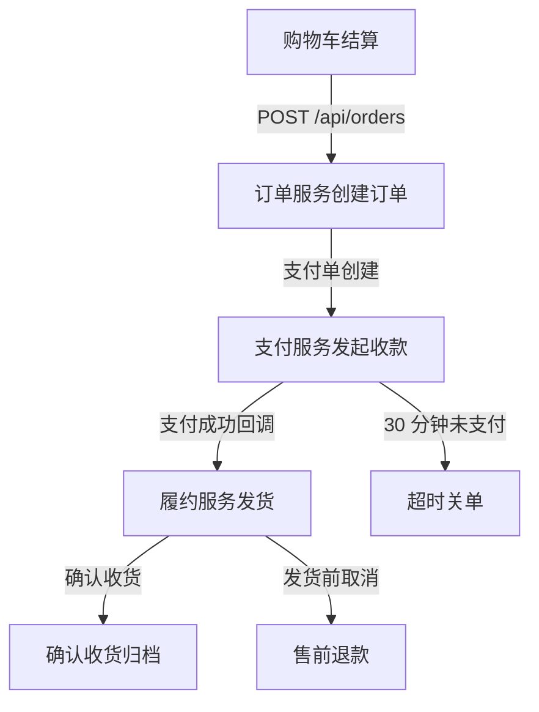

# 系统概览

订单中台负责「下单 → 支付 → 履约」这条主链路。外围还有商品、用户、库存三个服务，
它们通过接口与本系统交互。

**下单到履约的主链路**

## 改造带来的变化

改造前，下单接口在高峰期会同时出现超卖与超时。改造后把库存扣减收敛到数据库事务内，
并把支付回调做成幂等，两个问题一起消失。

**关键指标（对照改造前）**

| 指标           | 值   | 说明                 |
| -------------- | ---- | -------------------- |
| 下单 P95       | 180  | 改造前 320ms         |
| 超卖事故       | 0    | 库存以数据库事务为准 |
| 支付回调失败率 | 0.02 | 加入幂等重试之后     |
| 关单延迟       | 32   | 定时任务改批量后     |

## 边界

订单中台**不负责**商品信息维护与物流轨迹查询——它只保存下单时的商品快照与物流单号。
商品改价不影响历史订单，这是对账的前提。
