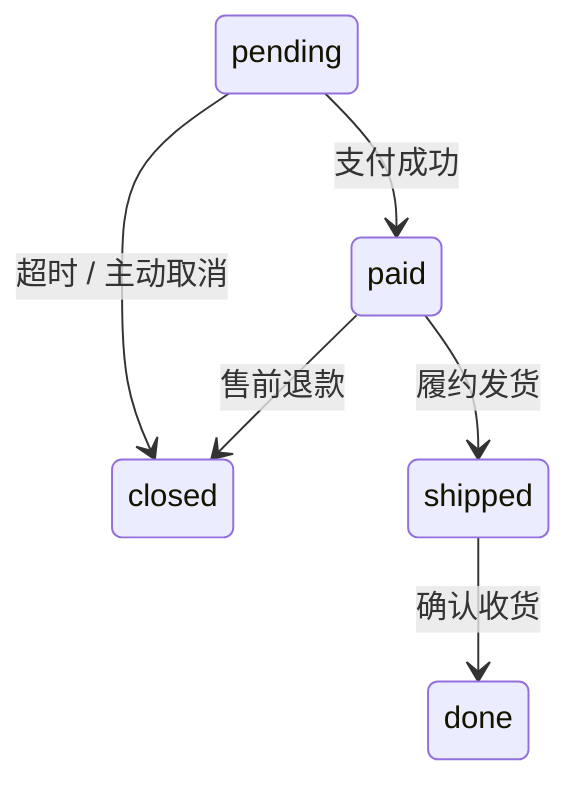

# 订单状态机

一笔订单只会沿着这张图向前走，**没有回退迁移**。所有迁移都在服务端校验，
客户端拿到的 `status` 只是结果。

**订单生命周期**

| 状态      | 名称           | 类型     | 说明                                      |
| --------- | -------------- | -------- | ----------------------------------------- |
| `pending` | 待支付         | 起点     | 下单成功、等待付款；30 分钟未付自动关单。 |
| `paid`    | 已支付（当前） |          | 支付回调确认，等待履约。                  |
| `shipped` | 已发货         |          | 物流单号已生成。                          |
| `done`    | 已完成         | 终态     | 确认收货，归档只读。                      |
| `closed`  | 已关闭         | 异常终态 | 超时未付或用户取消，库存回滚。            |

## 为什么没有「回退」

回退意味着要把已经发生的副作用——扣减的库存、发出的货、收到的钱——逆向撤销，
这在分布式系统里没有便宜的解法。所以设计上把「改主意」表达成**新动作**：
退款、退货、关闭各是一条独立流程，而不是把状态改回去。

**状态迁移的已知风险**

| 风险                                         | 影响                                         | 处置                                                                          | 严重度 |
| -------------------------------------------- | -------------------------------------------- | ----------------------------------------------------------------------------- | ------ |
| 支付回调与关单定时任务可能同时命中同一笔订单 | 若不加锁，会出现「已关闭订单又变成已支付」。 | 状态迁移统一走带条件的 UPDATE（WHERE status = 期望值），影响行数为 0 即放弃。 | high   |
| 履约系统重复推送发货事件                     | 同一物流单号可能被写两次。                   | 以「已发货」状态作为幂等键，重复事件直接忽略。                                | medium |
| 历史数据里存在没有支付单的「已支付」订单     | 对账时出现无法解释的差额。                   | 待数据组补录；本季度按人工核对处理。                                          | low    |
